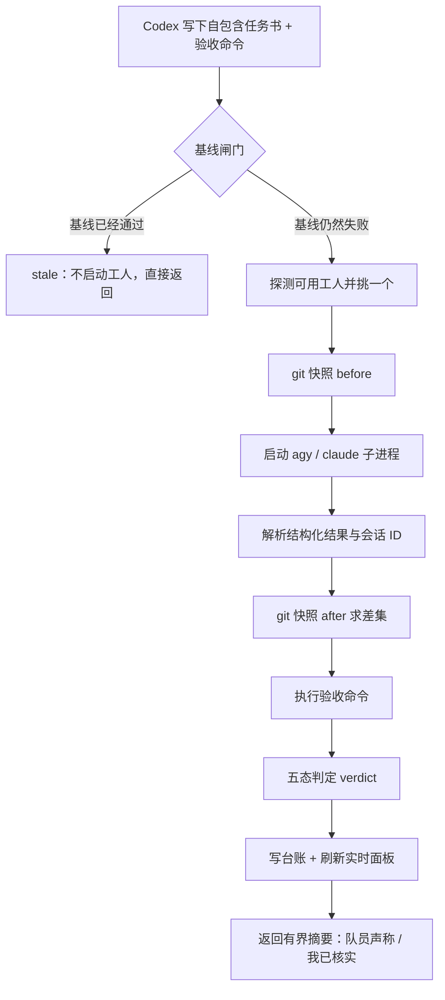

# Wolfpack for Codex

连接 Codex 与工人 CLI（Antigravity CLI 的 `agy`、Claude Code CLI 的 `claude`）的本地任务委派工具。

Wolfpack 把「派活、执行、验收、记账」串成一条流水线：Codex 负责拆任务、定验收标准、审查结果，工人 CLI 负责真正动手改代码、跑命令，Wolfpack 负责留下过程痕迹并汇总可核实的证据。你可以通过 MCP 工具调用，也可以直接使用命令行。

项目使用 Node.js 原生模块构建，无第三方运行时依赖。

## Codex 版的定位与三版区别

这一版保留 **Wolfpack for Codex** 的专供定位：Codex 当队长，通过 MCP 或 CLI 将完整任务交给外部工人，再根据磁盘变化与验收证据审查结果。配套 [AGENTS.md](AGENTS.md) 给出了选档策略、目标式任务书、收口三件套、会话续跑及验收铁律；适合已经在 Codex 中组织开发工作的用户。

三版共用设计思想，但分别维护实现。希望得到最完整的原生插件交互，请选 [DSH 版](../dsh/README.md)：按钮开关、工人复选框、工具卡片和侧栏面板由宿主承载。希望独立接入其他 MCP 客户端或脚本，请选 [通用版](../universal/README.md)。本版不提供 DSH 原生按钮，工人偏好与路径用环境变量或配置设置，观察能力通过独立 HTTP 面板提供。

| 能力 | Codex 本版 | DSH 版 | 通用版 |
| --- | --- | --- | --- |
| 队长约定 | AGENTS.md，详述拆任务与独立验收 | briefing 随插件开关接入 systemPrompt | briefing 按需交给宿主 |
| 工具 | 六个 MCP 工具 | 四工具，面板走宿主侧栏 | 六个 MCP 工具 |
| 工人选择 | 配置偏好、自动轮换与续跑沿用 | 原生勾选启用集合，支持自动挑选 | 配置偏好、自动轮换与续跑沿用 |
| 状态观察 | status / live / panel 与 health | 原生卡片、侧栏，健康在摘要中 | 同本版 |
| 非 Git 文件探测 | 显示无法判定，依靠验收 | 文件快照回退 | 有界文件快照回退 |

这里的“专供”指接入说明和队长工作方式，而不是另一套模型服务。工人登录与供应商由 agy / Claude Code 配置继承；Wolfpack 不要求把宿主 Codex 的供应商改成工人供应商。

## 概览

### 这一版有什么

- **两个工人都能用**：`agy` 与 `claude` 装了哪个就用哪个，两个都装则自动轮流派活，调用方无法也不需要在调用时挑工人。会话按工人各自延续（agy `--conversation` / claude `--resume`），换工人必然冷启动。
- **实时看得见**：`wolf live` 一条命令看现在跑到哪一步，`wolf panel` 起本地只读面板，把两个工人分节展示——各自的运行、步骤、会话流水、停滞监控与 token 累计，每 3 秒自刷新，不消耗任何模型额度。
- **停滞有报警**：两个工人各有一套监控，分别盯着自己的会话文件是否还在写；5/10/15 分钟没有进展时各报一次，随后闭嘴，**只报警、永不自动终止**。
- **坏工人会被冷落**：没输出 / 超时挂住 / 额度或 API 中转池子耗尽 / 未登录这类「工人自己的毛病」会在当轮被识别，该工人进入冷却（5–30 分钟，视原因而定），下一轮自动改派另一个工人；冷却到期自动恢复，也支持一条命令手动解除。
- **台账不留黑洞**：派发的一瞬间就先写一条 `running` 记录，收工再补完整结果。哪怕外层超时把 CLI 进程掐掉、工人却在后台跑完了，`wolf_status` 也能看见这次派发，而不是查无此事。
- **宿主可替换**：核心层不绑定运行环境，进程派生统一走 `src/runtime/` 注入的实现——自带 Node 版，DSH 一类宿主可以换成自己的运行时。

### 它不做什么

- 不提供沙箱或任务目录隔离：工人在你给的目录里直接读写文件、执行命令，权限范围由你决定。
- 不会因为「看起来卡住了」就替你杀掉进程，也不会替你把失败的任务重跑一遍（它只会把坏掉的工人暂时冷落、改派另一个，见「工人健康与自动冷却」）。
- 不托管工人的登录、配额与网络代理，这三件事仍由 `agy` / `claude` 自身的配置决定。
- 不替你做判断：任务边界、验收标准、结果可不可信，最终仍由你确认。

### 谁干什么

| 角色 | 负责 | 不负责 |
| --- | --- | --- |
| Codex（队长） | 拆任务、写自包含任务书、给验收命令、审查证据 | 手写大段实现、把整库上下文搬进自己的会话 |
| `agy` / `claude`（工人） | 在自己的会话里读代码、改文件、跑命令、回报结构化结果 | 决定任务边界、判断自己的产出是否可信 |
| Wolfpack（引擎） | 基线闸门、独占锁、产物差集、验收执行、台账、实时面板与工人健康冷却 | 替工人思考、替你拍板 |
| 你（负责人） | 定目标、定权限范围、看结果 | —— |

## 为什么要用它：把贵的那一半用在判断上

Codex 和工人 CLI 都在「聊天」里干活，但成本结构完全不同。驱动 Codex 的模型额度消耗快、单价高；驱动工人（`agy`，以及用 CC Switch 接入的 `claude`）的模型用量便宜得多，而在目标明确、边界清楚的编码任务上通常足够可靠。真正稀缺的是**判断力**——拆任务、定验收标准、审查结果——而不是敲键盘的动作。

打个比方：装修一套房子，既要有设计师定方案、盯效果，也要有施工队刷墙铺砖。让设计师亲手刷墙，付的是设计师的时薪，速度却未必比工人快；反过来让施工队自己拍板方案，返工的概率又太高。Wolfpack 就是把这两件事分开的那道工序：Codex 出方案、下判断、做验收，动手的活交给工人（`agy` / `claude`），贵的额度只花在真正需要判断力的地方。

省下来的额度主要来自三处：

- **上下文不搬家**：不必把代码库和长对话灌进贵模型，工人在自己的会话里读文件、跑命令。
- **轮数被压缩**：一次 `wolf_delegate` 把「派活 + 执行 + 验收」合成一到两轮，而不是来回十几轮。
- **会话可复用**：同一 `task_id` 续跑复用工人会话，省掉冷启动开销；累计用量超过阈值才强制冷启动。

省钱的前提是任务本身**能被机械验收**。目标含糊、需要反复澄清的活派出去，只会把成本换成返工。

反过来说，有几类任务不适合交给 Wolfpack：需要来回澄清的模糊需求、必须实时交互探索的问题，以及你自己都说不清「完成」长什么样的活。这些任务派出去，省下的额度会以返工的形式还回来，还多搭上一轮沟通成本。判断标准很简单——你能写出验收命令，就值得派；写不出来，就先自己把目标想清楚。

## 核心能力

- **任务委派**：提交独立任务，收集执行结果、文件改动和验收输出。
- **会话续跑**：使用稳定的 `task_id` 关联工人会话（agy / claude）；支持强制新会话与累计 token 阈值控制。
- **并发执行**：一次提交最多 8 个任务，并发数可设为 1–4，默认 2。
- **独立验收**：执行调用方提供的检查命令，将执行者自述与实际检查结果分开呈现。
- **基线检查**：派发前确认问题仍然存在，避免重复处理已满足条件的任务。
- **任务管理**：查询历史、查看运行状态，并终止指定任务的进程树。
- **双工人自动轮换**：装了谁用谁，两个都在就交替派活；固定工人可写配置，工人不可用时自动回退并如实标注，不假装跑过。
- **五态判定**：`pass` / `fail` / `stale` / `error` / `unverified`，验收命令跑没跑起来、有没有通过、有没有必要派活，各自分得清楚。
- **可回溯台账**：NDJSON 台账记录轮数、verdict、停止原因、token、缓存读、会话 ID 与停滞采样，`status` 随时可查。
- **零依赖、离线可测**：只用 Node 原生模块，`node tests/run.mjs` 内置几十项用例，全程不调用真实工人、不消耗额度。
- **实时面板**：只读 HTTP 面板（`/wolfpack/panel`）把 `agy` 与 `claude` **分开展示**：各自的运行、当前步骤、会话流水、停滞监控与 token 累计，每 3 秒自刷新，零 token。
- **停滞监控**：两个工人**各有一套**监控，分别盯着自己的会话文件（agy 看 `~/.gemini/antigravity-cli`，claude 看 `~/.claude/projects`）。窗口 5/10/15 分钟各报一次，**只报警、永不自动终止**。
- **工人健康与自动冷却**：按故障类型给两个工人各自记账——工人自身故障（没输出 / 超时 / 额度与容量不足，含 API 中转池子的 `402`、`无可用渠道`、`额度不足` 等 / 未登录与鉴权失败）当轮即冷却，普通失败连续 2 次才冷却；下一轮自动改派另一个工人，两个都在冷却时仍硬试最早恢复的那个，永不空转。`wolf health` 看状态，`wolf health --reset claude|agy|all` 手动解除。
- **运行时注入**：核心层不绑定任何宿主，进程派生统一走 `src/runtime/` 注入的运行时（Node 自带实现，DSH 等宿主可换成自己的）。

适合目标明确、可以独立执行且有验收方式的开发任务。有依赖关系的任务应按顺序执行；多个任务同时修改同一文件时，需要调用方协调。

### 一次委派的生命周期



整个过程只需要队长一到两轮：派活那一次调用返回时，执行结果、磁盘改动和验收输出已经在同一条摘要里。看进度是另一条只读旁路，随时可查，也不会把成本转嫁回队长。

## 快速开始

### 环境要求

- Node.js 20 或更高版本。
- 至少安装一个工人 CLI（装了哪个就用哪个，两个都装则自动轮流派活）：
  - Antigravity CLI（`agy`）：已安装并完成登录，`agy --help` 可正常执行；
  - Claude Code CLI（`claude`，适合用 CC Switch 切换供应商的场景）：`claude --version` 可正常执行。工人进程直接继承 `~/.claude/settings.json`，切换供应商后无需在 Wolfpack 侧改配置。
- 使用 MCP 接入时，需要支持本地 stdio MCP 服务的客户端；也可以仅使用 CLI。

```sh
node --version
agy --help
claude --version
```

### 获取项目

```sh
git clone https://github.com/Cofran-77/wolfpack.git
cd wolfpack/codex
```

本仓库为私有仓库，克隆前需要具有访问权限并完成 GitHub 身份验证。项目无需执行 `npm install`。

运行离线测试和只读状态查询：

```sh
node tests/run.mjs
node bin/wolf.mjs status --json
```

测试使用内置模拟执行器，不依赖真实 agy / claude，也不消耗其模型调用额度。`status` 只读取任务记录；它成功返回不代表已经验证工人的登录或任务执行能力。

### 三分钟上手

克隆下来先跑通离线部分，确认引擎本身没问题，再决定接哪个工人：

```sh
node --version                     # 需要 20 或更高
node tests/run.mjs                 # 离线用例：基线、判定、续跑、并发、面板、停滞监控、工人健康冷却
node bin/wolf.mjs status --json    # 只读台账；一次活都没派过也会正常返回空列表
node bin/wolf.mjs health           # 只读工人健康：谁在冷却、还剩多久
```

接好 MCP 之后，最省事的用法是直接在 Codex 里描述任务并给出验收命令，例如「用 wolfpack 给这个仓库的 parser 补空输入回归测试，验收命令是 npm test」。队长会把它整理成自包含任务书，调用 `wolf_delegate` 派出去，再把「队员声称」和「我已核实」两段一起带回来。

想看进度时，让队长调用 `wolf_live`（一次只读快照），或者自己起面板：

```sh
node "/absolute/path/to/wolfpack/codex/bin/wolf.mjs" panel
# 面板：    http://127.0.0.1:8787/wolfpack/panel
# 实时 JSON：http://127.0.0.1:8787/wolfpack/live
```

面板是纯只读的，看进度不会启动工人，数据只走浏览器、不进模型上下文；端口被占用时会自动改用空闲端口，命令行会把实际地址打出来。注意 `wolf_live` 不一样：它虽然也不启动工人，但**回执会整段进入调用方（主线程）的上下文并常驻**，之后每轮都要重读，所以长任务期间应当少查、等结束再看，或直接用面板。

### 接入 Codex

将以下内容加入 Codex 的 MCP 配置（通常为 `~/.codex/config.toml`），把占位路径替换为实际绝对路径：

```toml
[mcp_servers.wolfpack]
command = "node"
args = ["/absolute/path/to/wolfpack/codex/bin/wolf-mcp.mjs"]
env = { WOLFPACK_AGY = "/absolute/path/to/agy", WOLFPACK_CLAUDE = "/absolute/path/to/claude" }
```

两个工人的路径都写上，它们就都会参与自动轮换；只想先用一个也行——写了哪个就用哪个，另一个按 PATH 查找，找不到就视为没装。Windows 路径可使用正斜杠，agy 可执行文件通常为 `agy.exe`。如果客户端无法找到 `node`，也应将 `command` 改为 Node.js 的绝对路径。

也可以通过 Codex CLI 注册：

```sh
codex mcp add wolfpack \
  --env "WOLFPACK_AGY=/absolute/path/to/agy" \
  --env "WOLFPACK_CLAUDE=/absolute/path/to/claude" \
  -- node "/absolute/path/to/wolfpack/codex/bin/wolf-mcp.mjs"
```

重新加载客户端或开启新会话后，调用 `wolf_status` 检查服务是否可用。可用工具如下：

| 工具 | 用途 |
| --- | --- |
| `wolf_delegate` | 委派一个任务，返回执行摘要与验收结果 |
| `wolf_team` | 并发执行一组独立任务 |
| `wolf_status` | 只读查询历史和运行状态 |
| `wolf_kill` | 终止指定任务的进程树 |
| `wolf_live` | 只读实时状态（agy / claude 分节展示当前跑到哪了） |
| `wolf_panel` | 起本地实时面板并返回地址（只读 HTTP，重复调用复用同一个服务） |

MCP 服务需要由具有本地进程执行能力的客户端启动。仅有网页聊天界面并不等于能够启动本地 stdio 服务。

### 与 CC Switch 等配置管理工具共存

Wolfpack 的 MCP 注册写在 `~/.codex/config.toml`。有些配置管理工具（例如 CC Switch）在切换供应商或模型时会**整体重写**该文件，只保留它自己管理的 MCP 服务，`[mcp_servers.wolfpack]` 会被一并抹掉，表现为切换之后客户端里再也看不到 `wolf_status` 等工具。

为了不反复手工补配置，切换之前先做两件事：

1. 把 Wolfpack 加进该工具的 MCP 管理清单（例如 CC Switch 的「MCP 管理」）并勾选 Codex，让它每次写配置时带上这一条。
2. 切换完成后完全退出并重开客户端。工具列表在会话创建时确定，已有会话不会自动出现新工具，新开一个任务最稳妥。

万一仍然丢失，用上面的 `codex mcp add` 命令补回来即可。排查顺序：先确认 `~/.codex/config.toml` 里 `[mcp_servers.wolfpack]` 是否存在，再重启客户端。

### 工作目录与权限

**任务执行和验收命令都以进程的工作目录为准。** CLI 应从待处理项目目录启动，并通过绝对路径引用 Wolfpack 的入口脚本。MCP 模式使用服务进程的工作目录；当前工具参数不支持逐任务指定 `cwd`，接入时应确认客户端为服务设置的工作目录。

建议在 MCP 配置中显式设置 `WOLFPACK_AGY` 与 `WOLFPACK_CLAUDE`，避免依赖客户端的 PATH 或工作目录；路径写绝对路径时只探测存在性，不会再去搜 PATH。需要指定配置文件时，可设置 `WOLFPACK_CONFIG_FILE` 为其绝对路径。

**两个适配器默认都绕过工人的权限提示**（agy 传 `--dangerously-skip-permissions`；claude 传 `--dangerously-skip-permissions`，可用 `WOLFPACK_CLAUDE_PERMISSION_MODE` 改为 `plan`、`acceptEdits` 等 `--permission-mode`）。Wolfpack 本身不提供沙箱或任务目录隔离。请在你授权修改的工作区中使用，并明确任务范围与验收要求。

## 使用方式

### 单任务委派

通过 `wolf_delegate` 提交完整、独立的任务描述：

```json
{
  "task_id": "fix-parser-empty-input",
  "task": "修复当前项目中 parser 对空输入的处理，补充回归测试，并运行相关测试。保持既有公共接口不变。",
  "verify": ["npm test"]
}
```

`npm test` 是目标项目的验收命令示例，请替换为实际检查命令。工人不会自动获得 Codex 当前对话的上下文，任务描述应包含必要的背景、目标、约束和交付要求。

CLI 提供对应操作。以下示例从目标项目目录执行，入口路径需替换为实际安装路径：

```sh
node "/absolute/path/to/wolfpack/codex/bin/wolf.mjs" delegate --task-id fix-parser-empty-input --task "修复 parser 空输入处理并补充回归测试" --verify "npm test"
```

**工人由 Wolfpack 全自动挑选，无需也无法在调用时指定**：只装了一个就用那一个；两个都装则交替派活，让 `agy` 与 `claude` 都真正承担执行；同一个 `task_id` 的上一轮工人仍可用时会沿用以续用会话。需要固定工人时改配置（`"worker": "agy"` 或 `"worker": "claude"`，该工人不可用时自动回退到另一个）。

**坏掉的工人会被自动冷落**：某轮出现工人自身故障（没输出 / 超时 / 额度或中转池子耗尽 / 未登录）时，它会立刻进入冷却，下一次派活自动换另一个工人，并照样把「谁被跳过、为什么、还剩多久」写进 digest；详见「工人健康与自动冷却」一节。

常用参数：

| MCP 参数 | CLI 参数 | 说明 |
| --- | --- | --- |
| `task_id` | `--task-id` | 任务标识；同一任务续跑时复用，不相关任务使用新标识 |
| `task` | `--task` | 自包含的任务描述 |
| `verify` | `--verify` | 验收命令；MCP 使用数组，CLI 可重复传入 |
| `verify_baseline` | `--verify-baseline` | 派发前的基线检查；任一命令通过则跳过派发 |
| `fresh` | `--fresh` | 放弃该任务原有会话，重新开始 |
| `model` | `--model` | 指定本次使用的工人模型 |

基线检查适合确认某个已知失败是否仍然存在。应使用针对该问题的检查命令，避免将无关的成功检查误判为任务已完成。

### 任务书与验收推荐写法（目标式 + 硬收口）

把任务书写成「第几行改成什么」是双向浪费：判断权被队长收回，工人退化成打字机，出了错还得自己查。推荐**给目标、给边界、给验收，路径留给工人**，再用收口三件套把自由度关进笼子：

- **目标式任务书**：背景与当前状态 + 一句可判定的完成定义 + 允许改动的范围 + 不得破坏的接口与数据。
- **输出契约**：要求工人按固定结构回报——做了什么、声称改了哪些文件、有哪些不确定项。摘要里的「队员声称」段就来自这里。
- **最低执行要求**：工人必须自己跑指定命令，并回报原始输出要点，不接受「已测试通过」五个字。
- **不确定项申报**：明确允许「拿不准 / 需要决策 / 环境缺失」作为结果，禁止静默降级或伪造成功。

**验收要断言内容，别只看命令有没有报错。** 文件存在、exit code 0 只能说明工人跑完了，说明不了产物对。示例 `verify.py`：

```python
# 内容级验收：条目数、ID 集合、字段取值、证据文件都要对得上
import json, pathlib

events = json.loads(pathlib.Path("out/events.json").read_text(encoding="utf-8"))
assert len(events) == 9, f"应有 9 条事件，实际 {len(events)}"
assert {e["event_id"] for e in events} == {f"D{i:03d}" for i in range(7, 16)}, "事件 ID 集合不符"
for e in events:
    assert e["doc_url"].strip(), "doc_url 不得为空"
    assert e["granularity"] in {"national", "provincial", "prefecture"}, e["granularity"]
assert len(list(pathlib.Path("evidence").glob("*.md"))) >= 6, "证据文件少于 6 个"
```

```json
{
  "task_id": "extract-policy-events",
  "task": "背景、完成定义、边界、输出契约、必须自己跑的命令、不确定项申报要求，一次写全。",
  "verify": ["python3 verify.py"]
}
```

验收命令必须**不通过就退出非零**；把断言写进脚本，比让工人口头保证可靠。若要先确认问题确实存在，用 `verify_baseline`：基线命令一旦通过就跳过派发，避免工人白跑。

### 并发任务

调用 `wolf_team`，或将以下内容保存为 `tasks.json`：

```json
[
  {
    "task_id": "parser-tests",
    "task": "为 parser 模块补充边界测试，仅修改该模块的测试文件。",
    "verify": ["npm run test:parser"]
  },
  {
    "task_id": "api-docs",
    "task": "根据现有接口实现更新 API 文档，仅修改 docs/api 目录。",
    "verify": ["npm run docs:check"]
  }
]
```

将任务与检查命令调整为目标项目的实际内容后执行：

```sh
node "/absolute/path/to/wolfpack/codex/bin/wolf.mjs" team --tasks tasks.json --concurrency 2
```

MCP 调用的参数形式为 `{ "tasks": [...], "concurrency": 2 }`。同一批任务不能使用重复的 `task_id`；同一个任务运行期间也不能再次委派。

### 查询与终止

```sh
node "/absolute/path/to/wolfpack/codex/bin/wolf.mjs" status --json
node "/absolute/path/to/wolfpack/codex/bin/wolf.mjs" status --task-id fix-parser-empty-input --json
node "/absolute/path/to/wolfpack/codex/bin/wolf.mjs" kill --task-id fix-parser-empty-input
```

`status` 不启动工人，也不执行验收命令。任务记录默认位于当前用户的 `~/.wolfpack` 目录，可通过配置修改。

### 实时面板与停滞监控

```sh
# 打印一次实时状态（纯只读，两个工人分节展示）
node "/absolute/path/to/wolfpack/codex/bin/wolf.mjs" live
node "/absolute/path/to/wolfpack/codex/bin/wolf.mjs" live --json

# 起本地实时面板（只读 HTTP，默认只监听 127.0.0.1:8787；端口被占用自动改用空闲端口）
node "/absolute/path/to/wolfpack/codex/bin/wolf.mjs" panel
node "/absolute/path/to/wolfpack/codex/bin/wolf.mjs" panel --port 8790 --token <口令>
```

面板把两个工人**分成两节**渲染，并展示各自的路由原因（自动轮换 / 续跑沿用 / 配置指定 / 唯一可用 / 回退）。路由只读下面三个地址，纯只读、零 token，数据不会进入模型上下文：

| 路由 | 内容 |
| --- | --- |
| `/wolfpack/panel` | 面板 HTML（内联 CSS 与脚本，无构建、无依赖） |
| `/wolfpack/live` | 实时 JSON（上限 32KB，两个工人都保证出现在有界响应里） |
| `/wolfpack/health` | 健康检查 |

在 Codex 会话里也可以直接调用 MCP 工具：`wolf_live`（一次只读快照）与 `wolf_panel`（起面板并返回地址，重复调用复用同一个服务）。

停滞监控判据是**这个工人自己还在不在写东西**，两个工人各看各的会话存储：`agy` 看 `~/.gemini/antigravity-cli` 下的 `conversations/<id>.db*` 与 `brain/<id>/.system_generated/logs/transcript*.jsonl`；`claude` 看 `~/.claude/projects/<项目目录>/<sessionId>.jsonl`（**Claude Code CLI 的会话流水，不是 Claude Desktop**）。默认每 30 秒采样一次，5/10/15 分钟没有写入时各报警一次，随后闭嘴；报警写入停滞台账（默认与台账同目录的 `stall.ndjson`）并打到控制台。

**监控只报警、永不终止任何进程**：要不要停由你决定（Esc / 停会话 / `wolf kill`）。报警只是提示，也可能是这个工人正在长时间思考或跑一条很慢的命令。

### 工人健康与自动冷却（坏工人不会每轮都撞）

「CLI 装着、但没登录 / 接口报错 / API 中转池子额度耗尽 / 进程挂着不说话」是最难缠的状态：它看起来可用，于是每一轮都被挑中、每一轮都失败一遍。狼群为此维护一份**工人健康台账**，把这类故障识别出来，先把该工人冷落一段时间，下一轮直接改派另一个工人。

故障分两类，处理力度不同：

| 类别 | 判据 | 处理 |
| --- | --- | --- |
| **工人自身故障** | 没有输出 / 超时挂住 / 额度与容量不足（含中转池子 `402`、`429`、`insufficient_user_quota`、`无可用渠道`、`额度不足` 等）/ 未登录或鉴权失败（`401`、`invalid API key` 等） | **当轮立即冷却**，不等累计 |
| **普通失败** | 工人回了话、但自报失败（`stop_reason=error`） | 连续失败达到 `WOLFPACK_WORKER_FAIL_THRESHOLD`（默认 2 次）才冷却 |

冷却时长按故障类型区分：容量/额度类 5 分钟（等池子回血）、超时与普通失败 10 分钟、未登录/鉴权失败 30 分钟（需要人去处理）。**到期自动恢复**，不需要手动干预。被跳过的工人会在 digest 里写明「⛔ 谁在冷却、原因、还剩多久、本轮改派给了谁」，不会闷声换人。

三条铁律：

1. **永不空转**：两个工人都在冷却时，仍会挑最早恢复的那个硬试一次，并在 digest 里说明；
2. **显式点名优先**：配置里写了 `WOLFPACK_WORKER=claude` 就照用，冷却会被忽略（但会标注）；
3. **只影响挑选，不影响判定**：任务本身跑得好不好，仍然只由产物快照与机械验收说话。

```sh
# 看谁在冷却、冷却到什么时候（纯只读）
node "/absolute/path/to/wolfpack/codex/bin/wolf.mjs" health
node "/absolute/path/to/wolfpack/codex/bin/wolf.mjs" health --json

# 我修好了（重新登录 / 换 key / 池子充了钱），立刻解除冷却
node "/absolute/path/to/wolfpack/codex/bin/wolf.mjs" health --reset claude
node "/absolute/path/to/wolfpack/codex/bin/wolf.mjs" health --reset all
```

`wolf_status` 与实时面板（`/wolfpack/live`、`/wolfpack/panel`）也各自展示两个工人的健康状态：面板在每个工人分区里直接写「冷却中 · 原因 · 剩余时间」。台账文件默认是 `<台账目录>/worker-health.json`，缺失或损坏一律当空台账处理，绝不会因为台账问题拦下派活。整套机制可以关：`WOLFPACK_WORKER_HEALTH=off`。

## 结果判定

摘要分别展示“队员声称”和“我已核实”。前者是执行者报告，后者包含文件改动探测与验收命令结果。

| `verdict` | 含义 |
| --- | --- |
| `pass` | 已配置的验收命令全部成功执行并通过 |
| `fail` | 验收命令已执行，但存在未通过的检查 |
| `error` | 检查无法正常执行等工具或环境错误 |
| `unverified` | 未提供验收命令，无法据此确认任务达标 |
| `stale` | 基线检查中已有命令通过，因此跳过本次派发 |

执行状态与验收结论是两个不同维度：工人报错后，如果检测到文件改动，执行状态仍可能被标记为 `completed`；验收全部通过时也可能恢复该状态。**`completed` 不等于 `verdict: pass`，文件存在或发生改动也不代表内容正确。**

非 Git 工作区无法通过 Git 状态计算改动差集，此时会报告“无法判定”。应结合明确的验收命令和必要的人工审查判断结果。

CLI 正常返回的结构化结果也可能包含失败结论；自动化调用应使用 `--json` 并检查 `verdict`，不要只依赖进程退出码。

## 配置

可参考 [wolfpack.config.example.json](wolfpack.config.example.json) 创建本地 `wolfpack.config.json`。默认从当前工作目录向上查找配置文件；`WOLFPACK_CONFIG_FILE` 可指定要读取的文件。

常用配置优先使用对应环境变量，再使用 JSON 配置值，最后采用默认值。

| JSON 配置项 | 环境变量 | 默认值 / 说明 |
| --- | --- | --- |
| `agyPath` | `WOLFPACK_AGY` | 从 PATH 查找 `agy`，Windows 为 `agy.exe` |
| `worker` | `WOLFPACK_WORKER` | 工人偏好：`auto`（默认，全自动：装了谁用谁、两个都装则轮流）/ `agy` / `claude` |
| `claudePath` | `WOLFPACK_CLAUDE` | 从 PATH 查找 `claude`，Windows 为 `claude.exe` |
| `claudeModel` | `WOLFPACK_CLAUDE_MODEL` | 仅对 claude 生效的模型覆盖，优先于 `WOLFPACK_MODEL` |
| `claudePermissionMode` | `WOLFPACK_CLAUDE_PERMISSION_MODE` | 不设时与 agy 对齐（绕过权限提示）；可设 `plan`、`acceptEdits` 等 |
| `claudeAgents` | `WOLFPACK_CLAUDE_AGENTS` | 透传 `--agents <json>`，定义 claude 的自定义子智能体 |
| `mode` | `WOLFPACK_MODE` | `accept-edits` |
| `model` | `WOLFPACK_MODEL` | 由 agy 决定 |
| `effort` | `WOLFPACK_EFFORT` | 由 agy 决定 |
| `ledgerPath` | `WOLFPACK_LEDGER` | `~/.wolfpack/runs.ndjson` |
| `rawDir` | `WOLFPACK_RAW_DIR` | `~/.wolfpack/raw` |
| `taskTimeoutMs` | `WOLFPACK_TASK_TIMEOUT` | `0`，不设置 Wolfpack 任务超时 |
| `verifyTimeoutMs` | `WOLFPACK_VERIFY_TIMEOUT` | `300000` 毫秒 |
| `continuationTokenBudget` | `WOLFPACK_TOKEN_BUDGET` | `1000000`，累计用量达到阈值时触发新会话 |
| `stall.windowSeconds` / `stall.windowSecondsByWorker` | `WOLFPACK_STALL_WINDOW`、`WOLFPACK_STALL_WINDOW_AGY` / `WOLFPACK_STALL_WINDOW_CLAUDE` | `300`（秒）：多久没有进展算疑似停滞；`0` / `off` 关闭该工人的监控 |
| `stall.warnings` / `stall.warningsByWorker` | `WOLFPACK_STALL_WARNINGS`（可加 `_AGY` / `_CLAUDE` 后缀） | `3`：最多报警几次；`0` 只采样不打扰 |
| `stall.pollSeconds` | `WOLFPACK_STALL_POLL` | `30`（秒）：采样间隔，下限 5 秒 |
| `stall.toast` | `WOLFPACK_STALL_TOAST` | 默认 `false`。设 `true` / `1` 时在 macOS 弹系统通知（CLI/MCP 下默认不打扰） |
| `stallLogPath` | `WOLFPACK_STALL_LOG` | `<台账目录>/stall.ndjson`：停滞报警台账（NDJSON） |
| `stall.storeRoots`（或旧版顶层 `stallStoreRoots`） | `WOLFPACK_AGY_STORE_ROOT` / `WOLFPACK_CLAUDE_STORE_ROOT` | 覆盖对应工人的会话存储根（默认 `~/.gemini/antigravity-cli` 与 `~/.claude/projects`） |
| `workerHealth.enabled` | `WOLFPACK_WORKER_HEALTH` | `true`：工人健康与自动冷却总开关；`off` 完全退回老规则 |
| `workerHealth.filePath` | `WOLFPACK_HEALTH_FILE` | `<台账目录>/worker-health.json`：健康台账文件 |
| `workerHealth.failThreshold` | `WOLFPACK_WORKER_FAIL_THRESHOLD` | `2`：普通失败连续几次进入冷却（工人自身故障当轮即冷却） |
| `workerHealth.cooldownMs` | `WOLFPACK_WORKER_COOLDOWN_MS` | `600000`：普通失败冷却时长（毫秒） |
| `workerHealth.capacityCooldownMs` | `WOLFPACK_WORKER_CAPACITY_COOLDOWN_MS` | `300000`：额度/容量不足（含中转池子耗尽）冷却时长 |
| `workerHealth.timeoutCooldownMs` | `WOLFPACK_WORKER_TIMEOUT_COOLDOWN_MS` | `600000`：超时（疑似挂住）冷却时长 |
| `workerHealth.authCooldownMs` | `WOLFPACK_WORKER_AUTH_COOLDOWN_MS` | `1800000`：未登录/鉴权失败冷却时长 |
| `panelPort` | `WOLFPACK_PANEL_PORT` | `8787`：面板端口（被占用时自动改用空闲端口） |
| `panelHost` | `WOLFPACK_PANEL_HOST` | `127.0.0.1`：面板监听地址 |
| `panelToken` | `WOLFPACK_PANEL_TOKEN` | 不设：面板口令；设了就要求 `?token=` 或 `x-wolfpack-token` 请求头 |
| `panelRefreshMs` | `WOLFPACK_PANEL_REFRESH` | `3000`：面板自刷新间隔（毫秒，下限 500） |

会话阈值用于控制上下文续用，并不是费用上限或单次任务的硬 token 限额。实际模型用量由 agy 的返回数据决定。

本地配置、凭据和运行日志不应提交到仓库；项目的 `.gitignore` 已排除常见相关文件。

## 开发与文档

```sh
node tests/run.mjs
```

测试覆盖基线检查、结果判定、会话续跑、并发冲突、任务终止、配置解析和 MCP 工具发现等行为。

并发与任务终止用例按平台分成两份实现：`tests/concurrency.windows.test.mjs` 按 Windows 语义判断进程结束（`exitCode` 非空即可），`tests/concurrency.macos-linux.test.mjs` 同时接受退出码与信号（POSIX 下被 `SIGKILL` 终止的进程 `exitCode` 为 `null`，终止原因记录在 `signalCode`）。`tests/run.mjs` 按运行平台自动选择，两份文件除该判定外内容一致，修改时需同步。在 macOS/Linux 上运行测试要求 `node` 位于 `PATH` 中，否则部分用例会以 `exit 127` 之类的形式假失败。

```text
bin/          CLI 与 MCP 入口
src/          任务调度、验收、记录和进程管理
src/worker/   agy / claude 工人适配器
src/runtime/  运行时注入（Node 实现 + DSH 适配器 + 注入表）
src/stall.mjs 停滞监控内核（两个工人各一套，只报警不终止）
src/live-route.mjs / live-transcript.mjs / panel-*.js  实时路由、会话流水解析与面板
tests/       离线测试及模拟执行器
docs/        设计文档
```

- [设计说明](docs/DESIGN.md)：内部结构与实现背景。
- [委派操作手册](AGENTS.md)：供调用方参考的任务拆分与验收约定。接入现有项目时按需合并相关内容，避免覆盖已有项目指令。

修改后请运行相关检查，通过分支与 Pull Request 协作。单纯修改文档时，重点核对命令、参数、链接和描述是否与实现一致。

## 当前限制

### 本版已完善的验收与取消语义

所有登记验收均实际执行且通过才判 pass；有检查无法启动时判 error，不会忽略它。取消任务会终止目标工人树并保留共享 MCP 服务，跳过后续验收，最终保持 aborted；用户主动取消不计入工人故障冷却。任务名中的特殊字符、大小写与散列前缀做了碰撞防护。

这些行为已有本地及跨进程回归覆盖。运行测试使用模拟工人，不能由此保证真实服务的配额或登录始终有效。原详细介绍保留在 [历史文档](../docs/history/README-CODEX-ORIGINAL.md)，其中旧安装路径与旧能力描述以当前手册为准。

- 跨进程同任务检查依赖运行记录与进程存活探测，尚未使用原子文件锁，极端并发下存在竞态窗口。
- 并发任务共享调用方提供的工作区，不自动创建隔离目录或 Git worktree。
- 实时面板展示的是工人的会话流水尾部（有界取样，不是完整日志）。`claude` 在首轮尚未产生 `session_id` 时按工作目录下最新的会话文件兜底；`agy` 在首轮尚未产生 `conversationId` 时，只有在**恰好一个 agy 运行在跑**的情况下才按 `brain/` 下最新的会话兜底，多开时如实显示“会话 ID 尚未产生”，避免串台。claude 的子智能体用量会以 `subagent_stats` 汇总进 digest。
- 自动轮换状态保存在进程内：长期运行的 MCP 服务会稳定交替使用两个工人；CLI 每次调用都是新进程，两侧都可用且未配置偏好时从 `agy` 开始。
- Windows 上 `claude` 默认按 `claude.exe` 解析；若本机是 npm 安装得到的 `claude.cmd`，请设 `WOLFPACK_CLAUDE` 指向可执行文件。
- MCP 接口仅提供上述六个工具（`wolf_delegate` / `wolf_status` / `wolf_kill` / `wolf_team` / `wolf_live` / `wolf_panel`），未实现 Resources、Prompts 或订阅能力。实时面板与 `wolf_live` 都是只读的，不会因为「看进度」产生任何模型用量。
- agy 服务可用性、模型配额与权限行为由其自身环境决定，Wolfpack 不提供可用性保证。
