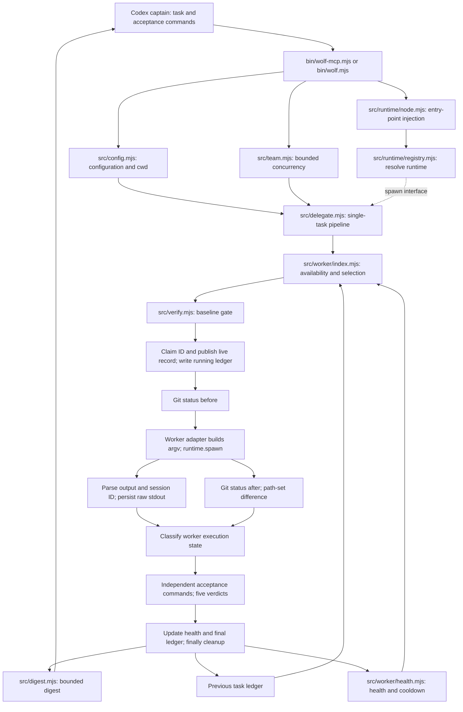
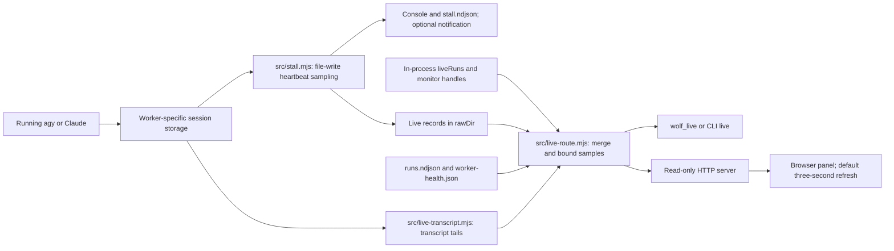
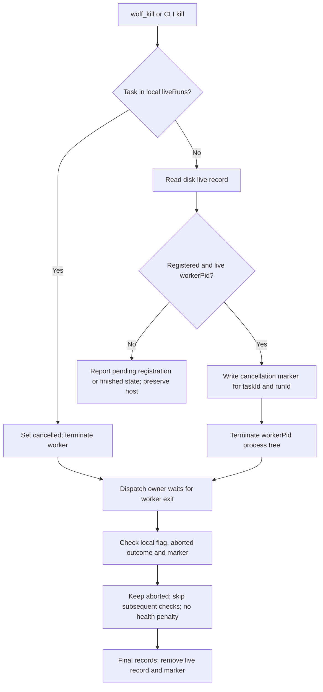

# Wolfpack for Codex Architecture

[简体中文](ARCHITECTURE.md) | **English**

[User manual](../README.en.md) · [Captain manual](../AGENTS.en.md) · [Design background](DESIGN.md)

This document follows the current `bin/` and `src/` implementation. Codex defines the brief and acceptance criteria; worker CLIs act on the workspace; Wolfpack connects execution with measured evidence. Runtime injection adapts process interfaces to a host. It adds neither a sandbox nor workspace isolation.

## Components and main flow

The runtime registry is an in-process injection point, not a network service traversed on every task. The entry imports the Node runtime and installs a default. At spawn sites, the core resolves an explicit runtime or that default, falling back to the built-in Node spawner when neither is injected. `runtime/dsh.mjs` supports another host without requiring Codex core modules to import DSH APIs. Worker processes, Git probes and verification all use the resolved spawn interface.

## Actual single-task order

1. Validate nonempty `task_id` and `task`; read previous task state and worker health; **resolve worker selection first**. Path/PATH discovery establishes apparent executable availability, not authentication, quota or provider availability.
2. Run the optional baseline. An unlaunchable check yields `error`; when checks launch and any passes, return `stale` with **no worker launch**. Nonpassing checks that only time out, with no ordinary failure, also yield `error`; otherwise dispatch proceeds. Multiple baselines do not require all to pass before skipping.
3. Claim the ID synchronously in the in-process registry, then inspect a disk live record and its host liveness. Reject an existing live run. Write an initial live file and add the process-local `liveRuns` entry.
4. Resolve continuation and **write the `running` verdict/stop-reason ledger entry before spawning**. Take the before Git snapshot, build adapter argv and start the worker. Publish its PID once available and keep updating live state through stall samples.
5. After worker exit, check local cancellation, the outcome and the cross-process marker. Take the after snapshot, parse output/usage/session ID, and persist raw stdout in `rawDir`. Output parsing and artifact probing are shown as one finish phase in the diagram; the code takes the after snapshot before parsing output.
6. Classify execution state. Cancellation skips subsequent acceptance. Otherwise run all registered commands in sequence. `pass` requires every check to launch and pass; a launch failure is `error`, a failed executed check is `fail`, and absent/skipped acceptance is `unverified`.
7. Where appropriate, salvage a worker-reported error using passing acceptance checks; update health, write final ledger state and return the digest. `finally` stops the monitor, releases the ID, and removes live and cancellation records.

`running` is an intermediate ledger state. The five final verdicts are `pass`, `fail`, `stale`, `error`, and `unverified`. `stop_reason: completed` describes execution rather than acceptance. Artifact detection or passing checks can salvage some worker-reported errors; the final verdict and scope of the checks still govern acceptance.

## Observation is a separate side path

Observation neither redispatches a task nor runs acceptance checks or worker model calls. `wolf_live` and `wolf_status` responses enter the captain's conversation; browser panel refresh data stays in the browser. The panel merges local memory with disk live records from other processes, groups agy and Claude separately and bounds live JSON to 32 KB.

agy monitoring reads its conversation databases and brain transcripts under `~/.gemini/antigravity-cli`; Claude monitoring reads Claude Code JSONL under `~/.claude/projects`. Default sampling is every 30 seconds, with one warning at each 5/10/15-minute idle window, then silence. **Stall monitoring only warns; it never terminates.** Missing IDs or storage are reported as unavailable. First-run latest-file fallbacks are observation heuristics, not acceptance evidence.

## Cancellation and shared processes

One MCP host can own several tasks. Cross-process cancellation therefore targets `workerPid`, not the live record's host `pid`. The marker tells the dispatch owner that the exit was caller cancellation, preventing detected artifacts from incorrectly recovering it as completed. Cancellation does not roll back files or actions already performed. Before PID registration it returns a retryable state; during post-worker cleanup it reports that the worker is finished. The post-exit cancellation check skips subsequent acceptance, but does not offer transactional undo at arbitrary points in the pipeline.

## State, routing and continuation

| State | Storage / purpose | Boundary |
| --- | --- | --- |
| Default runtime | Process-local registry | Separate per process; explicit injection takes priority |
| Active IDs and `liveRuns` | Process-local Maps | Synchronous same-ID claim; distinct IDs can run together |
| Live records and cancellation markers | `rawDir` | Cross-process observation/cancellation, not an atomic distributed lock |
| `runs.ndjson` | Default `~/.wolfpack/` | Dispatch/final records, session ID and cumulative reported usage; incremental reads and compaction |
| `worker-health.json` | Default ledger directory | Next-run selection, not acceptance semantics |
| Raw stdout | `rawDir` | Best-effort finish-time persistence, not the live transcript |
| `stall.ndjson` | Default ledger directory | Warning records; no process termination |

Selection uses configured preference, health, the previous worker, and a process-local rotation cursor. An explicit available preference can ignore cooldown and is labeled. When all available workers are cooling down, the earliest recovery candidate is tried. There is no automatic replay inside the current failed task. Persistent MCP calls rotate over time; new CLI processes reset the cursor. Same-ID continuation reuses only the same worker's session. A changed worker, explicit fresh request, disabled continuation or token/round/missing-usage threshold starts a new session. These are continuation policies, not hard spending limits.

## Git and concurrency limits

Artifact detection reads `git status --porcelain` twice and returns **dirty paths in after that were absent from before**. It is not a content diff or an audit of every claimed edit. Further edits to an already-dirty file, paths committed or cleaned during execution, and new files hidden under an already-reported directory can be missed. Unrelated concurrent workspace changes can enter this task's result. Outside Git, or if Git probing fails, detection is undetermined. Claimed-path boundary checks reduce misleading reporting but do not prevent actual writes outside the workspace.

The synchronous in-process claim rejects concurrent same-ID runs. The cross-process sequence—read live record, probe liveness, write live record—**has no atomic file lock**, leaving a simultaneous-start race. Ledger instances have their own write queues; different processes do not share them, and compaction plus concurrent writes is not a global transaction. Filename collision protection is not a concurrency lock. `wolf_team` permits up to eight tasks at concurrency 1–4, creates no worktrees, and does not prevent distinct IDs from editing the same file.

Acceptance must therefore test the actual goal and inspect file contents where necessary. Do not treat `changed_files`, live steps, worker claims or a leftover running entry as the sole evidence of completion.
