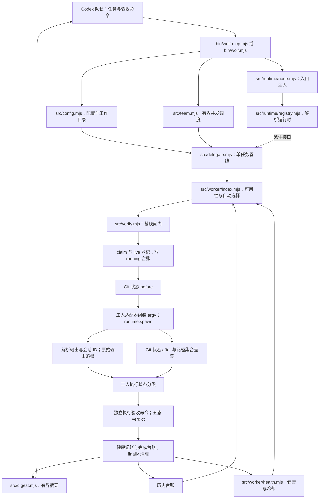
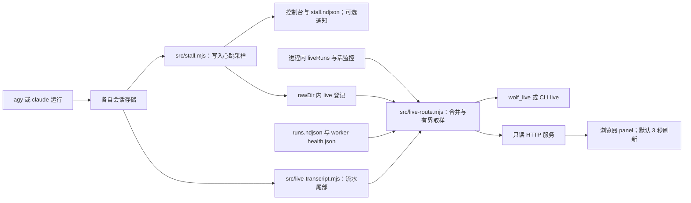
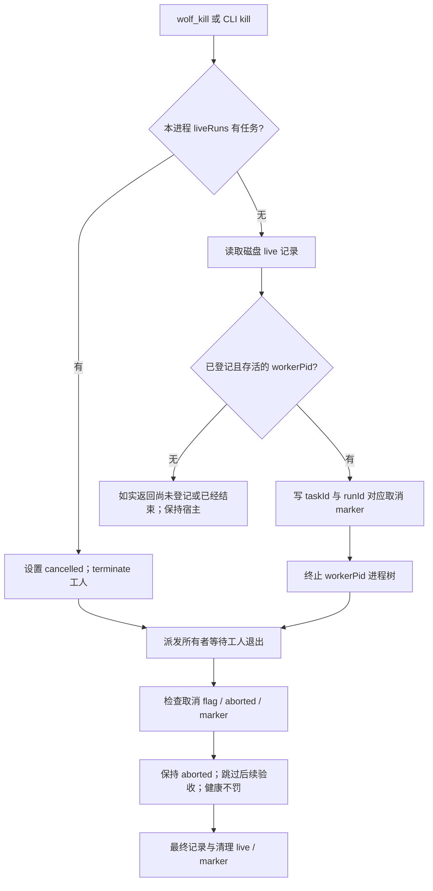

# Wolfpack for Codex 架构

**简体中文** | [English](ARCHITECTURE.en.md)

[使用手册](../README.md) · [队长执行手册](../AGENTS.md) · [设计背景](DESIGN.md)

本文件按当前 `bin/` 与 `src/` 的实现描述调用链。Codex 写任务书并决定验收标准，工人 CLI 读写工作区，Wolfpack 串接执行与证据。运行时注入解决宿主进程接口适配；它不提供沙箱，也不提供工作区隔离。

## 总体结构

运行时注册表不是每次派发都必须跨越的网络服务：入口导入 Node 运行时并设置进程内默认实现，核心在派生时解析显式运行时或默认实现，未注入时回退到内置 Node 派生器。`runtime/dsh.mjs` 提供其他宿主的适配点，Codex 核心无需导入 DSH 宿主 API。工人、Git 快照和验收均使用解析出的派生接口。

## 单任务实际顺序

1. 校验非空 `task_id` 与 `task`，读取该 ID 的历史与健康台账，**先解析工人选择**。选择只检查配置路径或 PATH 等可用性，不证明登录、额度或服务可用。
2. 执行可选基线。无法启动检查时返回 `error`；正常执行且任一通过时返回 `stale`，**不启动工人**。全部非通过检查仅超时且没有普通失败也判 `error`；否则放行。多个基线不是“全部通过才跳过”。
3. 进程内同步 `registry.claim` 占用 ID，再查询磁盘 live 记录及其宿主进程存活状态；已有活运行则拒绝。写初始 live 文件，建立进程内 `liveRuns` 条目。
4. 决定续跑或冷启动，**先写 `verdict=running`、`stopReason=running` 台账**，再拍 Git before 快照并派生工人。工人 PID 在派生后更新到 live 文件，停滞采样持续更新 live 状态。
5. 等工人退出后检查本地取消标志、退出结果和跨进程取消 marker；拍 after 快照；解析报告、用量与会话 ID；将原始 stdout 存入 `rawDir`。图中输出解析与 after 差集属于同一收尾阶段，代码先取 after 再解析输出。
6. 分类执行状态。取消跳过后续验收；其他情况按列表顺序执行所有注册验收。每一条都实际运行且成功才是 `pass`；启动失败为 `error`，执行失败为 `fail`，未验收为 `unverified`。
7. 必要时用机械验收救回工人自报错误，更新工人健康，写最终台账并返回摘要。`finally` 停监控、释放 ID、删除 live 与取消 marker。

`running` 是中间台账状态；最终五态是 `pass` / `fail` / `stale` / `error` / `unverified`。`stop_reason=completed` 是执行状态，不等于验收通过。产物探测或全部验收通过可救回部分工人自报错误，仍需按实际 `verdict` 和检查范围解读。

## 实时观察是旁路

观察不重新派发、不运行验收，也不调用工人模型。`wolf_live` 和 `wolf_status` 的回执进入队长上下文；浏览器面板的刷新数据走浏览器。面板合并本进程内存与其他进程的磁盘 live 登记，按 agy / claude 分区展示，有界 JSON 上限 32KB。

agy 读取 `~/.gemini/antigravity-cli` 下会话数据库与 brain 流水；Claude 读取 `~/.claude/projects` 下 Claude Code 的 JSONL。默认每 30 秒采样，5/10/15 分钟无观察到写入各报一次，随后静默。**监控只报警，不自动终止。** 缺少会话 ID 或可用存储时如实显示不可用；首轮最新文件回退只是观察启发式，不是验收证据。

## 取消与共享进程

一个 MCP 进程可承载多个任务，因此跨进程取消必须针对 `workerPid`，不能把登记中的宿主 `pid` 当成工人杀掉。marker 让派发所有者知道退出是用户取消，避免收尾时被已有产物救回为完成。取消不回滚磁盘文件；取消前已经执行的动作也无法撤销。工人 PID 尚未登记时返回可重试状态；工人已结束而宿主收尾时如实报告。退出后的取消检查跳过后续验收，但不提供任意时刻的事务撤销能力。

## 记录、选择与续跑

| 状态 | 位置 / 作用 | 边界 |
| --- | --- | --- |
| 默认 runtime | 进程内 registry | 每个进程独立，显式注入优先 |
| 活跃 ID 与 `liveRuns` | 进程内 Map | 同 ID 同步占用；不同 ID 可并发 |
| live 文件与取消 marker | `rawDir` | 跨进程观察与取消协作，不是原子分布式锁 |
| `runs.ndjson` | 默认 `~/.wolfpack/` | 派发与最终记录、续跑 ID、累计报告用量；增量读取与压缩 |
| `worker-health.json` | 默认台账同目录 | 影响下一轮选择；不改变验收语义 |
| 原始 stdout | `rawDir` | 收尾时尽力保存，非实时会话流水 |
| `stall.ndjson` | 默认台账同目录 | 记录报警，不触发进程终止 |

自动选择优先考虑配置偏好、健康、历史工人及进程内轮换。显式偏好可忽略冷却并标注；两个可用工人都在冷却时尝试最早恢复者。不会在当前失败任务中自动重试。长期 MCP 可持续轮换；CLI 新进程重置轮换游标。续跑按相同任务 ID 与相同工人复用会话；换工人、强制 fresh、禁用续跑或触发累计 token/轮数/未知用量门槛时冷启动。门槛是续跑政策，不是硬费用上限。

## Git 差集与并发的实质限制

Git 探测读取两次 `git status --porcelain`，计算 **after 脏路径集合减 before 脏路径集合**。它不是文件内容 diff，也不核对声称的每一处修改。派发前已脏文件的进一步修改、运行中提交或清理的路径、已被目录级条目覆盖的新文件都可能漏报；共享工作区其他任务的改动可能进入本轮结果。非 Git 或 Git 命令失败时标记无法判定。声称路径越界检查能降低误导，但不能阻止实际越界写入。

同进程 `claim` 的同步占用可以拒绝同 ID 并发；跨进程的“读 live → 探测进程 → 写 live”**没有原子文件锁**，同时启动仍有竞态窗口。台账实例有自己的写入队列，但多个进程不共享该队列，压缩和其他跨进程写入也不是一个全局事务。任务 ID 的文件名碰撞防护不等于并发锁。`wolf_team` 最多 8 个任务、并发 1–4，不创建 worktree，也不阻止不同 ID 同时改一个文件。

因此验收必须针对实际目标，必要时独立检查文件内容；不要把 `changed_files`、实时步骤、工人自述或遗留 running 记录作为唯一完成依据。
