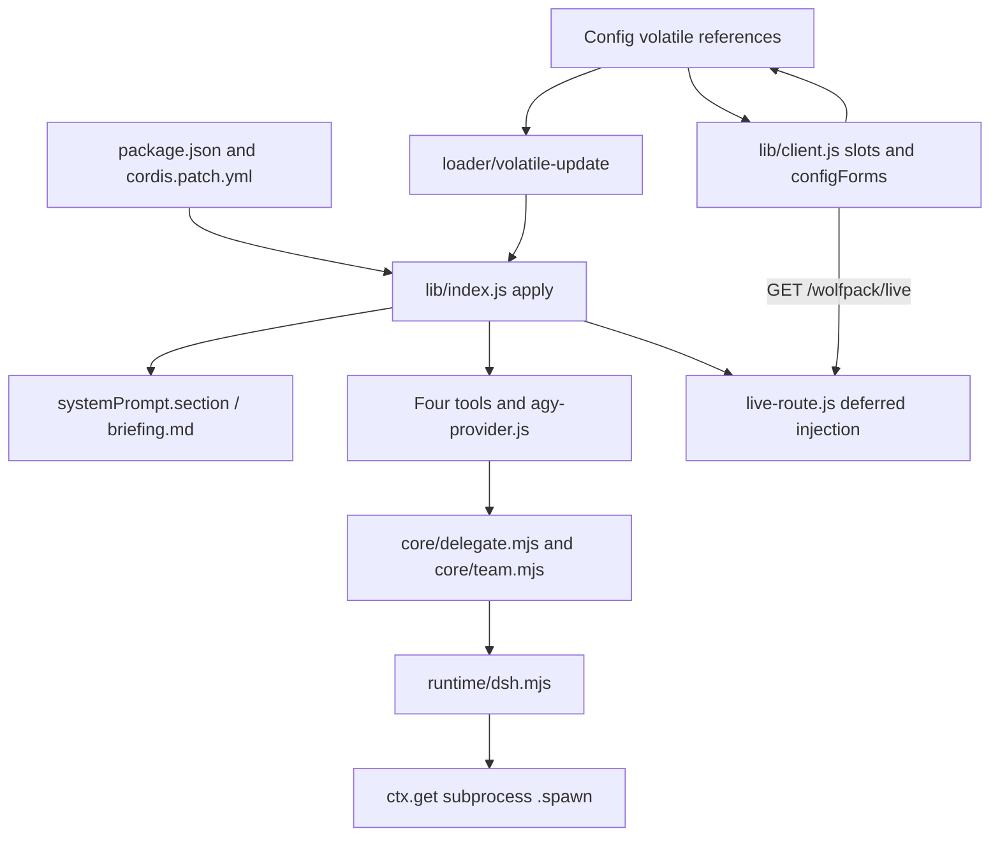
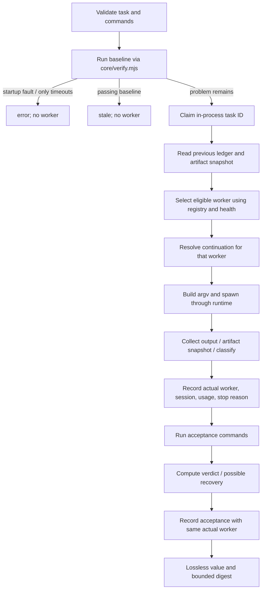

# DSH architecture and execution boundaries

[中文](ARCHITECTURE.md) · [Manual](../README.en.md) · [Worker directory](WORKERS.en.md)

This document describes the implementation in `dsh/`. The sibling editions maintain their own core copies; their six-tool panels and fixes are not implied here. DSH exposes four tools and a host-native panel route.

## 1. Host loading and lifecycle

`package.json` selects `lib/index.js` as the host entry and `lib/client.js` as the browser export. The DSH bundle points to `cordis.patch.yml`, which inserts plugin ID `wolfpack` and package name `wolfpack-unified`. The client declares DSH client-module, conversation, and settings injections, targeting the web platform. Node 20+ is required; host peer packages are `dsh-tools`, `dsh-subagent`, and `schemastery`.

The host hard-injects only `systemPrompt`. `apply(ctx, config)` installs a dynamic section named `wolfpack`, order 1200. Its text function checks current enablement and reads `briefing.md` (or `WOLFPACK_BRIEFING`) when the prompt is assembled. Disabled mode produces empty section text; an unreadable/empty briefing produces a diagnostic fallback. This separates captain policy from the execution mechanism.

An effect constructs `delegationFactory()` and synchronizes enablement. It soft-acquires `tools`, `subprocess`, and `subagents` through `ctx.get()` rather than undeclared service-property access. All three must exist to mount the delegation mechanism. Missing services leave the policy half available with a warning. On mount it registers the agy-named subagent provider and the four tools; optional harness handlers expose `wolf/live-runs` and `wolf/kill-run`. Disposers unregister tools, provider, handlers, and the live route.

`Config` has volatile `enabled`, `agy_enabled`, `claude_enabled`, `workers_enabled`, and hidden `workers_roster`. Defaults are off / true / false / empty CSV / module-load roster JSON. The loader updates volatile references in place and emits `loader/volatile-update`; the effect recalculates pool/preflight, then mounts or unmounts. Disabling mechanisms is not specified as a reliable way to cancel already running work; cancellation follows explicit handles/signals.

Host source is imported for the running host process; edits require full restart. The browser module is reloaded with the page, so an updated client can temporarily communicate with an older host module. Volatile settings are a separate mechanism and do not require restart.

## 2. Configuration and client boundary

`runConfig()` calls `loadConfig({ ledgerPath: LEDGER_PATH })`, but **does not spread the whole loaded object into the host runtime**. It copies the 26 specification path keys and uses `loadedConfig.workerHealth` as the health default, with a host environment off switch. Core executable paths, ledger creation, permission mode, model/effort, deadlines, continuation/budgets, and stall configuration are built by host-specific helpers/environment. The enabled pool comes from Cordis `computeWorkersEnabled()`.

Consequently the file's extension path keys and health settings can affect DSH, while its enabled list does not. `WOLFPACK_WORKERS_ENABLED` is a CLI/MCP loader input, not the DSH pool input. DSH's nonempty Cordis CSV overrides legacy core switches; names are normalized/deduplicated and unknown names logged. Empty/invalid-only lists are not a fail-closed “disable all” contract: the registry's empty-filter behavior can restore the core pool. Use the mode switch to disable tools.

Timeout units differ at the shell boundary: DSH's host helpers interpret task/verify environment values in seconds; the shared config loader parses numerical values as milliseconds. The host default worker deadline is off and acceptance deadline is 300,000 ms.

The hand-written client depends on `slots` and `configForms`. It subscribes to namespace snapshots and checks ready/writable status before updates. The worker menu parses `workers_roster`, writes stable roster-order CSV to `workers_enabled`, and rejects removing the last selection. It retries a rejected write once after rereading the snapshot. Snapshot subscriptions, not optimistic labels alone, represent current host state.

Roster generation lives in `core/worker/roster.mjs`; it uses pure filesystem/PATH checks and no subprocess spawn. It declares two core entries plus 26 specs, with `name`, label, bin, installed, and core metadata. It does not include contract/authentication/health as proof of usability. Extension installation probes use primary `spec.bin`, so aliases and configured extension paths can disagree with a badge. The roster default is generated at module load rather than being a continuous machine inventory.

## 3. Runtime and worker contracts

`DshRuntime` forwards argv, cwd, collection/spill options, grace period, and AbortSignal to the host subprocess service. It does not invoke an independent unmanaged child-process API. `NodeRuntime` supplies the standalone CLI/MCP shell instead. Both satisfy the common handle contract: completion promise, collected stdout/stderr, terminate, optional waitForExit/PID.

`core/worker/index.mjs` registers native `agy.mjs`, native `claude.mjs`, and `createWorkerFromSpec()` adapters from `specs.mjs`. Core names are exactly `agy` and `claude`; all 26 other entries require opt-in. `generic.mjs` refuses unknown contracts before execution and rejects stdin-only prompts because the current worker launch uses ignored stdin. It builds only specification-declared argv and parses JSON/JSONL through declared extractors; text output has no generic session or token extraction.

`resolve.mjs` is a leaf module using Node built-ins. This avoids a registry/adapter import cycle and centralizes PATH/PATHEXT resolution. Windows resolution tries alternative suffixes after a missing `.exe` path/name; the Claude adapter wraps resolved `.cmd`/`.bat` in `ComSpec /d /s /c`, adding `call` for spaces. Native executables and non-Windows launches use the direct target. This behavior is covered by fixtures, not proof of a live install's authentication.

Preflight means contract eligibility and path existence. It does not establish subscription, API access, approval behavior, or successful runtime parsing. Directory confidence and “installed” are independent concepts.

## 4. Delegation pipeline and session ownership

The model tool calls `runDelegateTask()` in `core/delegate.mjs`; team items call the same core through `core/team.mjs`. The legacy name `startAgy()` now routes through the registry and should not be read as a two-worker hard limit.

Selection considers the configured pool, preflight, preference, previous worker, and health. No enabled filter means only core workers. An explicit available preference can ignore its cooldown with diagnostics; unavailable/disabled preferences fall back. Automatic routing skips cooled candidates, preserves a healthy eligible previous worker, or rotates. If all candidates are cooled, it attempts the one due to recover first.

The selected worker is fixed **for the run**: argv, parsing, classification, session ownership, worker health, and receipts refer to the same adapter. The final acceptance ledger append uses `runResult.worker`, not a new selection after health may have changed. This prevents a receipt from assigning one worker's session ID to another worker.

Across rounds, ownership does not imply immutable worker binding. `resolveContinuation()` receives the selected worker name and clears the old session when the previous worker differs. Explicit fresh mode, absent IDs, continuation policy, token budget, unknown-usage cap, and round limits also cause cold starts with reasons. Native resumes pass exact IDs, agy `--conversation`, Claude `--resume`; a generic spec needs an extractor before its resume capability can be useful.

Worker completion and acceptance remain separate. The current verdict evaluates **executed** checks, so mixed passing checks and startup failures may yield pass. Recovery of a worker error also uses executed-check success and inherits that gap. Review registered counts and each `ran` field. Worker artifact recovery and claims reconciliation provide diagnostics, not universal proof of task correctness. Non-Git changed-file determination remains unavailable rather than falsely zero.

## 5. Process control and storage

The in-process `ActiveRunRegistry` in `core/ledger.mjs` reserves a task ID and rejects a duplicate. `liveRunHandles` in delegate stores kill/dispose/result handles for current runs. AbortSignal and deadlines flow into the runtime; explicit kill calls terminate/wait and records cancellation. Successful completion releases the active claim and removes the live handle in the result finalizer.

The code claims a task and creates its timer before artifact snapshot, worker selection, argv construction, and spawn. Exceptions during that early region can escape before the result finalizer is installed. Do not assume all pre-result startup failures are covered by the normal release path; fixtures and normal completion are not a general cleanup proof.

`core/live.mjs` contains filesystem record readers and a writer, but the current launch path does **not** call `writeLiveRecord()`. Cross-process kill therefore depends on records that already exist; it is not guaranteed for every newly launched task. Record lookup is not an atomic interprocess lock, and orphan-record reads do not implement the cleanup promised by older comments.

`RunsLedger` appends NDJSON and folds it on read. Worker result and acceptance are separate appends for the same round. It tracks sessions, worker, counters, changes, duration, verdict, and notes, with retention/compaction. A process-local Promise chain serializes writes; there is no interprocess file lock. The default path follows DSH-home resolution into `wolfpack/runs.ndjson`; environment overrides are available. Health and stall records are separate files to avoid contaminating round accounting.

`persistRaw()` writes collected worker stdout separately; spill paths preserve additional captured output when available. Both are bounded/fallible. `lossless.mjs` enforces valid plain JSON at tool boundaries: omit undefined object properties, reject invalid numeric values (including -0), invalid array elements/types, cycles, and nonplain instances. It does not silently coerce invalid data and does not promise unbounded output or arbitrary-precision numbers.

## 6. Panel route and observability

`live-route.js` registers exact `/wolfpack/live` through deferred `ctx.inject(['webServer', 'connection'])`, with a soft lookup fallback for older hosts. GET authorization is delegated to `connection.requestRejection()`. Missing authorization service returns 503; rejected requests preserve the host rejection status; other methods return 405. Responses are no-store. Mount/config receipts go to `live-route.log` beside the ledger.

The route merges active handles/registry and folded task history, reads bounded transcript tails, and caps payload to 32 KiB. Default visible run count is eight; requested larger counts are capped at 50. Transcript tails are bounded to 64 KiB, 12 recent events, and 400 characters per event before payload trimming. Finished-file tail caches use size/mtime and return copies to avoid cache mutation during trimming. This is host UI data, not conversation/model input.

The client sidebar fetches this route with retry backoff and timer cleanup; it is separate from `wolf_status` tool output. Status is read-only but costs captain-context reading when returned to the model. No worker-model execution occurs just to read status or the route.

`stall-monitor.js` and panel transcript lookup still follow the Antigravity storage layout. There are no separate Claude or extension transcript tracks here. A missing file/heartbeat yields unavailable evidence, not a confirmed stall. Warnings are limited and recorded separately; they never auto-terminate. Generic JSONL parsing after collection is not a streaming event bus.

## 7. Module map and verification scope

| Module | Responsibility |
|---|---|
| `lib/index.js` | Config, dynamic briefing, host runConfig, tool schemas, lifecycle |
| `lib/client.js` | Capsule/menu/settings, status/kill cards, sidebar and config snapshots |
| `lib/agy-provider.js` | DSH subagent-provider compatibility seam |
| `lib/runtime/dsh.mjs`, `node.mjs` | Host subprocess versus standalone execution |
| `lib/core/delegate.mjs`, `team.mjs` | One-task pipeline and bounded concurrent batches |
| `lib/core/worker/index.mjs` | Registry, eligibility, preference/rotation selection |
| `lib/core/worker/agy.mjs`, `claude.mjs`, `generic.mjs`, `specs.mjs` | Native and declarative argv/parse/classification contracts |
| `lib/core/worker/resolve.mjs`, `roster.mjs`, `health.mjs`, `faults.mjs` | Paths, UI roster, cooldown accounting, fault classification |
| `lib/core/verify.mjs`, `digest.mjs`, `lossless.mjs` | Mechanical checks, bounded presentation, valid tool JSON |
| `lib/core/ledger.mjs`, `live.mjs` | Folded audit/session state and optional disk live records |
| `lib/live-route.js`, `stall-monitor.js` | Host observation and warning-only monitoring |
| `bin/wolf.mjs`, `bin/wolf-mcp.mjs` | CLI and MCP stdio shells |

`tests/run.mjs` currently stages 11 named suites after checking DSH peer resolution. Coverage includes host/volatile/schema/client behavior, worker health/selection/registry, actual-worker receipt regression, roster, and Windows Claude command fallback. Fake CLI scripts and injected find/spawn functions exercise contracts without consuming worker subscriptions. Results must be taken from a current runner output; the historic fixed test count is not maintained here. No document-generation step establishes live vendor compatibility, a real DSH UI pass, or external CLI acceptance.

### Filesystem fallback and cross-process cancellation detail

When Git is unavailable, takeArtifactSnapshot falls back to a bounded filesystem snapshot (up to 10,000 files), comparing mtime/size and additions/deletions. A detected delta yields determined=true; no detected delta yields determined=false. This is not content hashing and can miss edits. Existing cross-process live records use direct worker/host PID SIGKILL, not Runtime process-tree termination, and may stop a shared host. New live-record writes are not wired.
