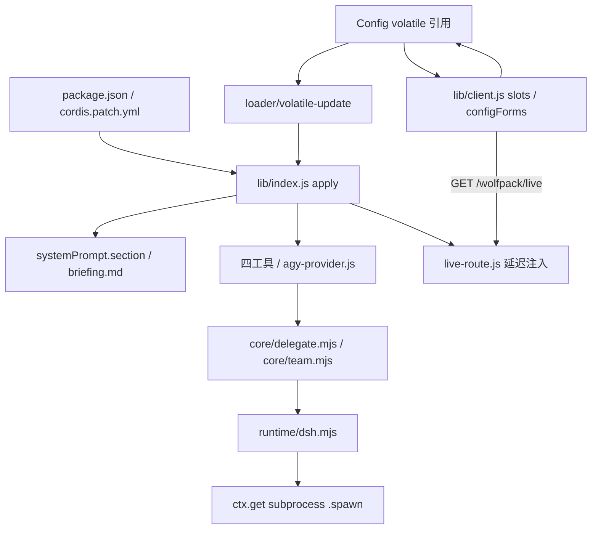
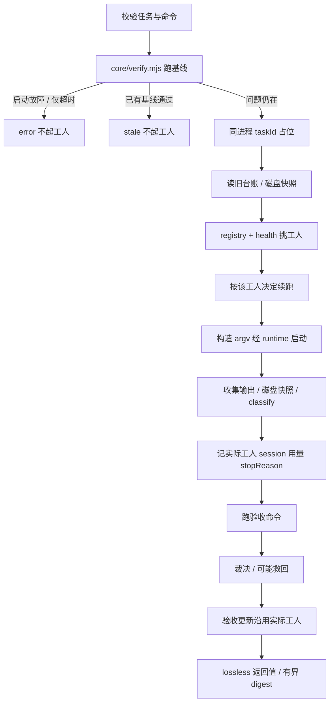

# DSH 架构与执行边界

[English](ARCHITECTURE.en.md) · [使用手册](../README.md) · [工人目录](WORKERS.md)

本文按 `dsh/` 当前实现说明。三个发行目录分别维护核心副本；兄弟版本的六工具面板、验收修复或监控能力不自动代表本版。本版是四工具加宿主原生侧栏路由。

## 1. Cordis 加载与生命周期

`package.json` 的宿主入口为 `lib/index.js`，浏览器导出为 `lib/client.js`。DSH bundle 引用 `cordis.patch.yml`，向 profile 插入 `id: wolfpack`、`name: wolfpack-unified`。客户端声明 DSH 模块、对话与设置 UI 注入，运行平台为 web。要求 Node 20+，宿主 peer 为 `dsh-tools`、`dsh-subagent`、`schemastery`。

宿主只硬注入 `systemPrompt`。`apply(ctx, config)` 注册名为 `wolfpack`、顺序 1200 的动态 section，正文函数每次组装时检查当前开关，再读 `briefing.md` 或 `WOLFPACK_BRIEFING`。关闭时正文为空，文件不可读或为空时使用带诊断的兜底。这是“队长怎么判断”的策略半。

另一个 effect 构造 `delegationFactory()` 并同步启用状态。机制半通过 `ctx.get()` 软获取 `tools`、`subprocess`、`subagents`，避免访问未声明注入服务的属性；三个服务都在才挂委派。缺服务时策略半仍可保留，工具缺席并告警。挂载注册 agy 命名的 subagent provider 与四工具；若 harness 存在，还注册 `wolf/live-runs`、`wolf/kill-run`。卸载函数撤销工具、provider、handler、实时路由。

`Config` 的 volatile 字段为 `enabled`、`agy_enabled`、`claude_enabled`、`workers_enabled`，以及 hidden 的 `workers_roster`。默认分别是关闭、开启、关闭、空 CSV、模块加载时生成的 roster JSON。loader 就地更新引用后发 `loader/volatile-update`；机制重新折算工人池/预检，再挂载或撤销。关闭插件不应被写成可靠终止已运行任务的替代方式，取消另走信号和句柄。

宿主源码 import 后不会因文件改动自动替换，须完全退出并重启；客户端随页面重新加载。因此升级中可能出现新前端接旧宿主。volatile 设置无需重启，是另一条独立链路。

## 2. 配置折算与客户端边界

`runConfig()` 调用 `loadConfig({ ledgerPath: LEDGER_PATH })`，但**没有把整个 loadedConfig 展开到宿主运行配置中**。实际采纳的是：26 个规格工人的 `<name>Path`，以及 `loadedConfig.workerHealth` 作为健康默认值（再用宿主环境开关决定是否关闭）。核心 agy/Claude 路径、台账对象、权限模式、模型/effort、时限、续跑预算、停滞设置由宿主自己的常量、环境与 helper 构造。启用池由 Cordis `computeWorkersEnabled()` 直接计算。

所以“DSH 完全不读配置文件”不准确；文件中的扩展路径和健康设置可进入本版，但文件的 `workers_enabled` 不控制宿主工人池。`WOLFPACK_WORKERS_ENABLED` 是 CLI/MCP loader 的输入，DSH 要改 Cordis `workers_enabled`。非空 CSV 优先于旧核心布尔开关，规范化去重并记录未注册名字。空数组或仅非法名不能作为可靠的“全禁用”：核心把空 filter 当无 filter，可恢复核心池；要关闭用 `enabled=false`。

超时单位也有宿主差异：DSH helper 将 task/verify 环境值按**秒**换算；共享 `loadConfig()` 对数字按**毫秒**解析。宿主默认工人无 wall-clock 上限，验收默认 300,000 ms。

手写客户端依赖 `slots`、`configForms`，订阅 namespace 快照并检查 ready/writable。下拉解析 `workers_roster`，按 roster 顺序稳定序列化 CSV 写入 `workers_enabled`，拒绝取消最后一个勾选。写入被拒时重读快照重试一次，并显示剩余拒绝原因。最终显示依赖宿主快照，不能把一次 accepted 当作永久幂等确认。

`core/worker/roster.mjs` 用纯文件系统/PATH 探测生成 2 核心 + 26 specs 的元数据，不 spawn。字段是 name、label、bin、installed、core，不是契约/认证/健康证明。扩展安装探测只看主 `spec.bin`，不完整覆盖自定义路径和别名；因此徽标可与真正预检不同。默认 roster 在模块加载时生成，不是持续机器盘点。

## 3. 运行时与工人契约

`DshRuntime` 将 argv、cwd、收集/spill 选项、宽限期与 AbortSignal 交给宿主 subprocess，不另起不受宿主管理的执行器。CLI/MCP 使用 `NodeRuntime`。两者满足统一句柄契约：done Promise、stdout/stderr collected、terminate，以及可选 waitForExit/PID。

`core/worker/index.mjs` 登记原生 `agy.mjs`、`claude.mjs`，及 `specs.mjs` 经 `createWorkerFromSpec()` 生成的适配器。核心名严格为 agy/claude，其余 26 项 opt-in。`generic.mjs` 对 unknown contract 直接 fail-closed；stdin-only 任务书也拒绝，因为当前工人启动路径 stdin 为 ignore。argv 来自规格声明，JSON/JSONL 解析依赖规格提取器；text fallback 没有通用 session/token 提取。

`resolve.mjs` 是仅依赖 Node 内建的叶子模块，消除 registry/adapter 循环依赖并集中 PATH/PATHEXT 解析。Windows 缺失 `.exe` 可尝试其它后缀；Claude 解析到 `.cmd`/`.bat` 后走 `ComSpec /d /s /c`，路径含空格加 `call`。真正 exe 与非 Windows 目标直接执行。夹具覆盖这些路径，不代表真实安装已登录可用。

预检只证明契约允许进入执行以及命令路径存在，不能证明订阅额度、API 连通、审批行为或解析成功。目录 confidence、installed、运行可靠性是三个概念。

## 4. 委派流程与会话归属

模型工具调用 `core/delegate.mjs` 的 `runDelegateTask()`，小队任务通过 `core/team.mjs` 调同一核。旧函数名 `startAgy()` 现在也走 registry，不能据此推断只能运行两工人。

挑选考虑启用池、预检、偏好、上轮工人与健康。无 filter 只候选核心工人；可用显式偏好可忽略冷却但写诊断，不可用/禁用则 fallback。自动挑选跳过冷却项，优先延用健康且可用的上轮工人，再轮换；全冷却则试最早恢复项并说明。

选定工人**在本轮固定**：argv、解析、分类、会话归属、健康及回执使用同一适配器。最终验收台账写 `runResult.worker`，不会在健康变化后重新挑选并把旧 session 记给另一工人。这是实际工人绑定与回执一致性。

跨轮不是永不换工人的硬锁。`resolveContinuation()` 收到所选工人名；与 previous.worker 不同就清掉旧 session，记冷启动原因。fresh、无 ID、续跑策略、token 预算、未知用量轮数兜底、轮数限制也会触发冷启动。原生续跑都传明确 ID：agy `--conversation`，Claude `--resume`；generic 必须能提取 ID 才能真正续跑。

工人结束与验收结论分开。当前 verdict 仅看**执行到了的检查**，一个检查通过、另一检查没启动仍可能 pass；工人 error 的验收救回也继承此边界。审核要读登记数量及每条 `ran`。磁盘产物救回与声明对账有诊断价值，不是任务正确性的普遍证明。Git 不可用时回退最多 10,000 文件的 mtime/size 快照：检测到新增、修改或删除时 determined=true；无差异时 determined=false。采样并非内容哈希，可能遗漏，不能把无法判定等同无改动。

## 5. 进程、取消与台账

`core/ledger.mjs` 的进程内 `ActiveRunRegistry` 对 taskId 占位并拒绝重复；delegate 的 `liveRunHandles` 保存当前运行的 kill/dispose/result 句柄。AbortSignal 和 deadline 传给 runtime，显式 kill 调 terminate/wait 并记录取消。结果 finalizer 正常释放占位、删除句柄并停止监控。

当前代码在磁盘快照、工人挑选、argv、spawn 之前先占位、建计时器；该早期区间的异常可能发生在结果 finalizer 安装前。不能把正常收尾覆盖误写为所有启动失败都保证清理；这是现有边界。

`core/live.mjs` 有磁盘登记读写函数，但当前启动路径**没有调用 `writeLiveRecord()`**。跨进程 kill 只在已有可用登记等条件下工作，不能承诺新任务全有效。读取登记不是原子跨进程锁，旧注释所说孤儿清理也未在只读列表实现中完成。

`RunsLedger` 追加 NDJSON，读取时折叠。同轮工人结果与验收是分别追加；保存 worker/session、用量、改动、时长、结论和原因，并有保留/压缩限制。Promise 链只在进程内串行，跨进程无文件锁。默认按 DSH home 阶梯定位 `wolfpack/runs.ndjson`，可用环境覆盖。健康和停滞独立落盘，不混入轮次统计。

`persistRaw()` 单独落 collected stdout，spill 可保留额外捕获输出；两者都有上限与失败可能。`lossless.mjs` 在工具边界保证纯 JSON：丢弃 undefined 对象字段，拒绝非有限数字/-0、非法数组项/类型、环和非纯对象；不把非法数字静默改成零。“lossless”不代表无限输出或任意精度。

## 6. 宿主路由与观察

`live-route.js` 经延迟 `ctx.inject(['webServer', 'connection'])` 注册 exact `/wolfpack/live`，旧宿主可回退软获取。GET 鉴权交给 `connection.requestRejection()`；缺服务 503，拒绝用宿主返回码，非 GET 405，响应 no-store。挂载与配置回执写台账旁 `live-route.log`。

路由综合活动句柄/registry 与折叠历史，读取有界 transcript 尾部，响应上限 32 KiB。默认展示 8 个运行，放大请求最多 50。每条 transcript 读 64 KiB 尾窗，最多 12 事件，每事件 400 字符，之后还可能按响应预算进一步削减。结束文件缓存按 size/mtime 复用，返回副本防止裁剪污染缓存。这些是宿主 UI 数据，不写会话、不进入模型。

客户端侧栏轮询路由、失败退避并清理定时器，区别于 status 工具。status 不启动模型/验收，但回执入队长上下文仍有阅读成本；持续观察优先侧栏。

`stall-monitor.js` 和面板 transcript 查询仍按 Antigravity 存储布局，尚未分接 Claude 与扩展工人的轨道。缺心跳是证据不可用，不是确诊停滞。告警有次数上限、另写台账，永不自动杀工人。generic 收集完再解析 JSONL 也不是实时事件总线。

## 7. 模块对应与验证范围

| 模块 | 职责 |
|---|---|
| `lib/index.js` | Config、动态 briefing、宿主 runConfig、工具 schema、生命周期 |
| `lib/client.js` | 胶囊/动态菜单/设置、status/kill 卡片、侧栏、配置快照 |
| `lib/agy-provider.js` | DSH subagent provider 互操作入口 |
| `lib/runtime/dsh.mjs`、`node.mjs` | 宿主 subprocess 与独立执行 |
| `lib/core/delegate.mjs`、`team.mjs` | 单任务流程及受控并发批次 |
| `lib/core/worker/index.mjs` | 登记、可用性、偏好/轮换 |
| `lib/core/worker/agy.mjs`、`claude.mjs`、`generic.mjs`、`specs.mjs` | 原生与声明式 argv/解析/分类契约 |
| `lib/core/worker/resolve.mjs`、`roster.mjs`、`health.mjs`、`faults.mjs` | 路径、菜单元数据、冷却台账、故障分类 |
| `lib/core/verify.mjs`、`digest.mjs`、`lossless.mjs` | 机械验收、有界呈现、宿主合法 JSON |
| `lib/core/ledger.mjs`、`live.mjs` | 审计/会话折叠状态及可选磁盘运行记录 |
| `lib/live-route.js`、`stall-monitor.js` | 宿主观察与只告警监控 |
| `bin/wolf.mjs`、`bin/wolf-mcp.mjs` | CLI 与 MCP stdio 外壳 |

`tests/run.mjs` 当前在 peer 解析检查后暂存执行 11 个具名套件，覆盖宿主/volatile/schema/client、健康/挑选/登记、实际工人回执回归、roster、Windows Claude cmd 回退。假 CLI、注入 find/spawn 验证契约，不消耗真实订阅。具体通过数以当次 runner 为准，不沿用旧固定计数。文档核对不代表真实厂商 CLI、真 DSH UI 或真实凭据已验收。

已有跨进程 live 登记的取消分支直接 SIGKILL 工人和宿主 PID，不是 Runtime 进程树终止；可能结束共享宿主。新登记写入仍未接线。
