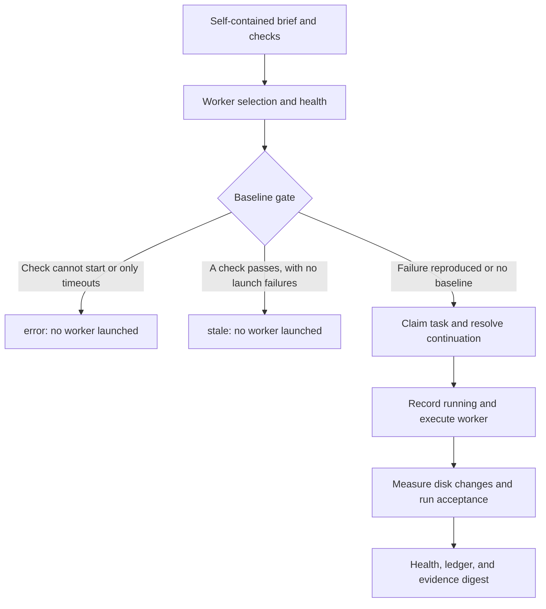

# Wolfpack — universal edition

[中文](README.md) | English

A host-neutral local task delegation engine with CLI and stdio MCP entry points. Use it from an AI client that supports local MCP servers, a terminal, CI, or your own Node.js host.

Requires Node.js **20 or newer**. There are no third-party runtime dependencies and no `npm install` step is needed to run this checkout. Real delegation requires an installed, authenticated Antigravity CLI (`agy`) or Claude Code CLI (`claude`). Ledger queries, health queries, and offline tests work without a worker.

## Capabilities and edition boundaries

- Two worker adapters, with availability checks, automatic rotation, continuation affinity, and fallback from an unavailable configured preference.
- Worker fault classification, persisted health, and cooldowns for capacity/quota, authentication, timeout, missing output, and repeated worker errors.
- Baseline gates, session continuation, cumulative token accounting, bounded team concurrency, worker process-tree cancellation, and a ledger entry at dispatch time.
- Six MCP tools: `wolf_delegate`, `wolf_status`, `wolf_kill`, `wolf_team`, `wolf_live`, and `wolf_panel`.
- Separate live views and session tails for each worker, a local read-only HTTP panel, and stall warnings that never automatically terminate workers.
- Git status differences and bounded snapshots of non-Git workspaces; worker claims are reported separately from measured evidence.

This edition is an independent CLI/MCP service. It does not require DSH or Codex-specific project instructions. For native controls beside the conversation input, worker checkboxes, tool cards, and a native sidebar, use the [DSH edition](../dsh/README.md). For Codex as the captain and its `AGENTS.md` operating conventions, use the [Codex edition](../codex/README.md). The universal edition uses its own HTTP panel and configuration/environment variables for worker preferences.

Universal and Codex both expose six MCP tools and dual-worker monitoring and health commands. Universal additionally offers non-Git file snapshots and programmatic core exports. The editions are maintained independently: matching tool names or package names do not guarantee identical behavior.

## How a delegation completes

The captain supplies a stable `task_id`, a self-contained brief, and acceptance commands. Wolfpack reads prior state and worker health, selects a worker, evaluates the baseline, claims the task, resolves continuation, and records dispatch. It then runs the worker, measures workspace changes, parses the result, runs acceptance checks, updates health and the ledger, and returns a digest separating claims from verification.



Workers do not inherit the captain's conversation. Avoid briefs such as “make the change discussed above.” Include background, a definition of done, allowed directories, interfaces that must remain compatible, delivery requirements, and checks. Ask for `summary`, `claimed_files`, and `uncertainties`; uncertainty is a valid report, not a reason to invent success. See the complete [captain's handbook](briefing.en.md).

## Baselines and strict acceptance

`verify_baseline` should reproduce the specific unresolved problem before delegation. An empty baseline allows execution. A baseline that cannot start produces `error`, even when another baseline passes. Otherwise, any passing baseline produces `stale` and no worker starts. When all checks time out, the result is `error`; a normal failing check can allow execution even if another check times out. Do not copy an ordinary list of already-passing health checks into a problem baseline: one passing check can skip the task.

All registered acceptance commands must actually execute and succeed for `pass`. A command that cannot start makes acceptance `error`; a failed or timed-out executed command makes it `fail`. A passing command does not conceal another command's launch failure. No acceptance commands means `unverified`. Cancellation skips subsequent acceptance checks and preserves `stop_reason: aborted`; it is not a passing verdict.

Artifact evidence can recover an execution that a worker reports as `ERROR`; fully passing mechanical acceptance can also recover an execution error as `completed`. Completion and verification are different axes: file changes do not prove correctness, and a recovered execution without checks remains `unverified`.

## Worker routing and continuation

With only one available worker, use that worker. With both available and no explicit preference, new tasks alternate within a long-lived MCP process. A later round for the same `task_id` favors the previous worker when it remains healthy and available. `agy` uses its conversation ID; Claude uses `--resume <session_id>`. A worker change forces a fresh session because IDs cannot cross CLI boundaries.

Set `WOLFPACK_WORKER=agy|claude` or JSON `worker` to prefer a worker. If that executable is unavailable, selection falls back and reports the reason. A preference for an available worker overrides its health cooldown and reports that override. Independent CLI invocations create new processes; their rotation cursor is not persisted, so they do not guarantee alternating workers.

Reuse the same ID for follow-up work on the same task; use a new ID for unrelated work. `fresh: true` / `--fresh` discards session reuse. Continuation also resets when disabled, when the configured round limit is reached, when accumulated reported token usage reaches the continuation budget (default 1,000,000), or when too many rounds lack usage information (default 20). The budget is a session-reuse threshold, not a billing cap or hard per-run token limit.

## Non-Git workspaces and evidence limits

In Git workspaces, Wolfpack compares the file-path sets from `git status --porcelain` before and after execution. This detects newly appearing dirty paths, not every content edit: further changes to an already-dirty path can be missed, and committed changes that leave a clean status may be absent.

For non-Git workspaces, the built-in Node runtime compares file size and modification time to detect additions, modifications, and deletions. It scans at most **10,000 visited entries**, does not follow symbolic links, and skips `.git`, `.wolfpack`, `.dsh`, and `node_modules`. The configured raw output directory, ledger file, and worker health file are excluded. Workspace and exclusion paths are canonicalized through real paths, including existing parent directories for not-yet-created output paths; this handles directory aliases and Windows junctions at the root.

A permission error or exceeded limit makes the snapshot unavailable; a partial scan is never reported as complete evidence. Writes that preserve both size and modification time can be missed. A custom injected runtime receives no implicit local filesystem fallback unless it explicitly advertises `supportsLocalArtifactSnapshot: true`. An undetermined change result is not proof of zero changes; use explicit acceptance commands and review the artifacts. Claimed paths outside the inspected workspace also make the evidence scope undetermined.

## Health, stall monitoring, and progress

Worker infrastructure faults trigger health accounting. Capacity/quota faults default to a five-minute cooldown, timeout and missing-output faults to ten minutes, and authentication failures to thirty minutes. Ordinary worker errors default to a cooldown after two consecutive failures. Health influences selection, not the acceptance verdict. Missing or corrupt health state is treated as empty state.

When all available workers are cooling down, automatic routing still tries the one due to recover first. Cooldowns expire automatically. `health` is read-only; `health --reset agy|claude|all` clears counters and cooldowns after you fix a login, quota, or executable-path problem. Avoid repeatedly redispatching the same task after a capacity error.

`wolf_status` reads recent task history or a specific task. It defaults to five tasks, with unfinished tasks first; the maximum limit is 100. MCP `wolf_live` returns one snapshot grouped by worker, defaults to eight runs with a maximum of 50, and excludes transcript tails unless `transcript: true` is requested. CLI `live` currently includes sampled transcript information in its output. Bounded sampling rotates across worker groups.

`wolf_panel` starts a read-only local panel; repeated calls to the same MCP service reuse its server. A port conflict falls back to a free port. By default it listens at `127.0.0.1:8787`, refreshes every three seconds, and shows each worker's runs, routing reasons, steps, transcript tails, tokens, and health. Configure a token if needed; requests then require `?token=` or `x-wolfpack-token`.

Current integration limitation: the universal CLI/MCP live and panel data-source builders do not pass the loaded `workerHealth` configuration into the payload builder, so their health sections can show empty/default state. Use CLI `health` or `wolf_status` for authoritative persisted cooldown information.

Each worker has its own session-file monitor: `agy` uses `~/.gemini/antigravity-cli`, Claude Code uses `~/.claude/projects`. The default no-progress warnings occur at 5, 10, and 15 minutes, then stop. Monitoring **only warns; it never kills a worker**. Long commands or extended reasoning can look stalled. Session tails are bounded samples, and unavailable session evidence is reported honestly to avoid mixing concurrent tasks.

Status/live queries do not start a model or run acceptance, but their receipts enter the calling AI's context. For continuous observation, use the panel instead of repeatedly sending large receipts into the conversation.

## Ledger, cancellation, and concurrency

Wolfpack appends `running` before worker execution and the full outcome afterward. This leaves a dispatch trace when an outer wrapper interrupts the host. The NDJSON ledger folds rounds into task state; raw worker stdout is saved separately for diagnosis.

The same task ID is exclusive within a process. Cross-process registration checks a live owner, but it is **not an atomic filesystem lock**. Teams do not create worktrees or isolate files automatically; define non-overlapping ownership before parallel execution.

Cancellation targets the worker process tree and keeps a shared MCP host running. An in-process flag records local cancellation; cross-process cancellation writes a separate `.cancel` request matched to `runId`, so periodic live-record updates cannot erase it. The completing delegate sees the request, skips acceptance, and records the aborted execution. If the worker PID has not yet been published, cancellation returns a retryable explanation; if it has ended, the result says so. Killing a worker does not roll back its file edits.

## CLI usage

Run these commands from the **target workspace**. If the engine is elsewhere, call its `bin/wolf.mjs` by absolute path.

```sh
node bin/wolf.mjs status --json
node bin/wolf.mjs health --json
node bin/wolf.mjs delegate --task-id fix-parser --task "Fix parser empty input; deliver a regression test and a summary of evidence" --verify "npm test"
node bin/wolf.mjs status --task-id fix-parser --json
node bin/wolf.mjs live --json
node bin/wolf.mjs panel
node bin/wolf.mjs kill --task-id fix-parser
node bin/wolf.mjs health --reset claude
```

Repeat `--verify` or `--verify-baseline` to register multiple commands. `--model` overrides the model for the current run, and `--fresh` requests a fresh session. The command examples are templates: replace the brief and checks with a complete, project-specific task.

Use `node bin/wolf.mjs team --tasks tasks.json --concurrency 2` with:

```json
[
  { "task_id": "parser", "task": "Complete independent parser brief", "verify": ["npm test"] },
  { "task_id": "docs", "task": "Complete independent documentation brief", "verify": ["npm run check-docs"] }
]
```

A team accepts one to eight tasks, defaults to concurrency two, and caps concurrency at four. Duplicate IDs reject the whole batch before any worker starts; task exceptions are isolated. Parallelize only independent tasks with clear file boundaries.

The CLI's successful process exit means the operation returned a result, **not** that the task passed. In automation, inspect the JSON `verdict` and `stop_reason`; do not accept an exit code of zero alone as task acceptance.

## MCP integration

A common JSON client configuration is:

```json
{
  "mcpServers": {
    "wolfpack": {
      "command": "node",
      "args": ["<absolute-checkout-path>/universal/bin/wolf-mcp.mjs"],
      "env": {
        "WOLFPACK_AGY": "<absolute-agy-executable-path>",
        "WOLFPACK_CLAUDE": "<absolute-claude-executable-path>"
      }
    }
  }
}
```

Keep only variables for installed workers, or omit executable variables when the client environment's PATH resolves them. On Windows, npm-installed Claude may expose `claude.cmd`; point `WOLFPACK_CLAUDE` to the actual launcher. Use your client's stdio MCP settings: supported fields and configuration locations vary. The [Codex edition](../codex/README.md) has its dedicated integration examples.

The worker's workspace is the **MCP service process's cwd**, not the directory containing the MCP script. Configure the client's working directory or launch the service inside the target project. Switching a client project does not necessarily change an already-running server's cwd; restart it with the correct directory. Explicit configuration and executable paths are more predictable than cwd-dependent lookup.

| MCP tool | CLI command | Purpose |
| --- | --- | --- |
| `wolf_delegate` | `delegate` | Execute, inspect, verify, and summarize one complete task |
| `wolf_status` | `status` | Read recent ledger state or a particular task |
| `wolf_kill` | `kill` | Cancel the worker for a particular task |
| `wolf_team` | `team` | Controlled concurrency for independent tasks |
| `wolf_live` | `live` | One live snapshot, with transcript disabled by default |
| `wolf_panel` | `panel` | Continuous local read-only panel |

Health management is a CLI command, not a seventh MCP tool. See [briefing.en.md](briefing.en.md) for complete tool arguments and captain workflow.

## Configuration and results

Wolfpack searches upward from cwd for `wolfpack.config.json`; use `WOLFPACK_CONFIG_FILE` for an explicit file. See the [example](wolfpack.config.example.json) and the full [configuration reference](docs/CONFIGURATION.en.md). Supported environment variables generally override JSON values. State defaults to `~/.wolfpack`; override with `WOLFPACK_LEDGER` and `WOLFPACK_RAW_DIR`. Historical DSH ledgers are not migrated automatically. Give different editions separate state paths when running them together.

| Verdict | Meaning |
| --- | --- |
| `pass` | Every acceptance command executed successfully |
| `fail` | Executed acceptance included a failure or timeout |
| `error` | An acceptance/baseline could not run, or another tool-level error occurred |
| `unverified` | No acceptance results are available, including cancellation that skips checks |
| `stale` | The baseline passed before dispatch; no worker was launched |

Execution `stop_reason` (such as `completed`, `aborted`, or `capacity`) is distinct from `verdict`. Inspect both. Never report “tests passed” for `unverified`.

## Troubleshooting

| Symptom | Interpretation and next step |
| --- | --- |
| No available worker | Check installation, authentication, PATH, and `WOLFPACK_AGY` / `WOLFPACK_CLAUDE`; changing the captain's model does not install a worker |
| Claude cannot start on Windows | Check whether the actual launcher is `claude.cmd`; set its explicit path |
| `stale` | The problem baseline passed; inspect whether the issue is already fixed or the baseline is inappropriate |
| `error` and checks did not start | Fix shell/path/environment; do not repeatedly dispatch a code fix for a shell failure |
| A worker is skipped | Read its cooldown reason; fix the underlying problem before health reset |
| Non-Git evidence is undetermined | Check scan bounds, permissions, and runtime capability; use explicit acceptance |
| MCP still edits the old project | Correct service cwd and restart the server |
| CLI exits zero but JSON says `fail` | The invocation completed; the task did not pass acceptance |

## Tests, programmatic exports, and package scope

```sh
node tests/run.mjs
```

The tests use simulated workers and do not spend real model quota. They cover adapters, routing, health, baseline/acceptance policies, continuation, concurrency, MCP, the panel, Windows launch faults, and regression cases.

The package exports `core/config`, `core/delegate`, `core/worker`, `core/team`, `runtime/node`, `runtime/dsh`, and `package.json`. These support custom hosts. Importing `runtime/node` registers its default runtime; `runtime/dsh` is a runtime adapter, **not installation of a complete Cordis plugin**. Prefer CLI/MCP for first integration; custom-host developers should read the [architecture](docs/ARCHITECTURE.en.md) and configuration reference.

The package manifest includes `bin`, `src`, `docs`, the Chinese README and briefing, the example config, and the license. Offline `tests` and the root-level English README/briefing are not explicitly included by that allowlist; use this repository checkout for the full bilingual documentation and tests. Old DSH plugin entry points and historical `lib/*` internals are outside the universal package's exported interface. The current native plugin lives in [DSH](../dsh/README.md), with historical Cordis material in `dsh/archive`. See [migration notes](../docs/MIGRATION.md) for boundaries and known limitations. MIT licensed.

```text
bin/                  CLI and MCP server
src/                  Configuration, delegation, checks, ledger, artifact detection
src/worker/           agy / Claude adapters, routing, faults, health
src/runtime/          Runtime registry and host handle adapters
src/live-*.mjs        Session tails and live payloads
src/panel-*.mjs, .js   Independent HTTP panel
tests/                Offline and regression tests
briefing.en.md        Goal-oriented briefs and captain acceptance conventions
```
