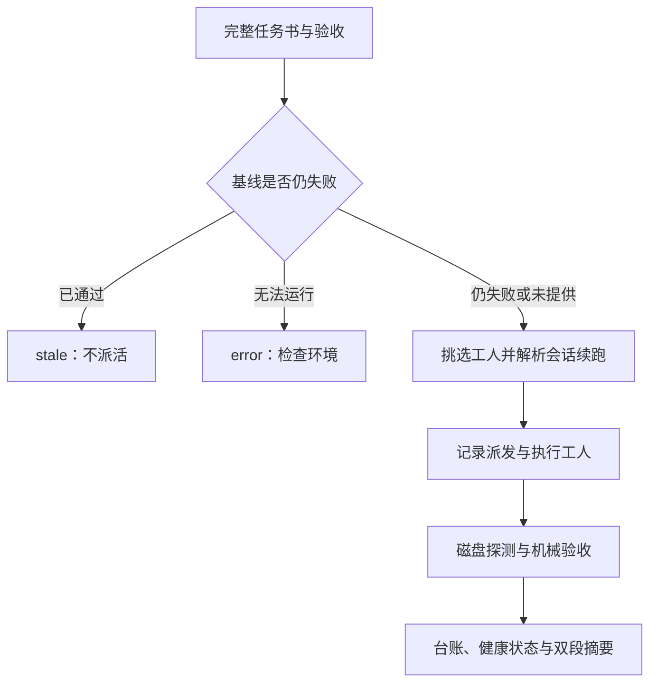

# Wolfpack

宿主无关的本地任务委派引擎，提供 CLI 和 stdio MCP 入口。适用于支持本地 MCP 服务的 AI 客户端，也可供终端和自动化脚本使用。

Node.js ≥20；无第三方运行时依赖，无需 `npm install`。真实派活需已安装并登录 Antigravity CLI (`agy`) 或 Claude Code CLI (`claude`)。没有工人时仍可读台账、查健康、运行离线测试。

## 能力

- 两种工人适配器；自动选择、轮换、续跑沿用与不可用回退。
- 工人故障识别、健康台账及冷却；容量、额度、鉴权、超时分别处理。
- 基线闸门、会话续跑、token 累计、受控并发、进程树取消和派发即记账。
- 六个 MCP 工具：`wolf_delegate`、`wolf_status`、`wolf_kill`、`wolf_team`、`wolf_live`、`wolf_panel`。
- 按工人展示实时状态与会话尾部、只读本地面板、停滞只报警不自动终止。
- Git 差集与非 Git 文件快照；队员自述和实测证据分开汇报。

## 通用版的定位与版本区别

这一版把 Wolfpack 作为独立 CLI/MCP 服务交给宿主使用。宿主可以是支持本地 stdio MCP 的 AI 客户端，也可以是终端、CI 或自己的 Node.js 调用程序。任务调度不要求安装 DSH，不要求 Codex 的项目指令格式。

如果希望在对话输入框旁直接开关狼群、勾选工人、查看原生工具卡片和侧栏面板，推荐 [DSH 版](../dsh/README.md)。如果主要由 Codex 当队长，使用 [Codex 版](../codex/README.md) 及其 AGENTS.md。通用版提供独立 HTTP 面板，工人偏好通过环境变量或配置设置，没有 DSH 原生按钮。

通用版与 Codex 版都有六个 MCP 工具、双工人监控与 health 命令。当前通用版还提供非 Git 工作区文件快照和程序化核心导出；Codex 版的重点是队长操作约定及 Codex 接入。三版独立维护，不能仅凭包名或同名工具假定所有实现完全一致。

## 一次委派如何完成

队长先准备 task_id、完整任务书和验收命令。Wolfpack 检查基线、锁定任务、解析续跑策略、记录本轮派发；随后执行工人、探测磁盘变化、解析工人结果、运行验收并补全台账。最后将“队员声称”和“我已核实”两段一起返回。



工人不继承队长会话，所以不要只写“按上面说的改”。至少给背景、完成定义、允许修改目录、不能破坏的接口、交付要求和验收。建议要求工人报告 summary、claimed_files、uncertainties；拿不准时明确申报，不用自述代替证据。更完整的目标式任务书与收口三件套见 [briefing.md](briefing.md)。

## 特性详解

### 基线闸门：已经解决的事不重复派

verify_baseline 必须针对当前问题，且在派活前失败。任意基线已通过时返回 stale；无法启动的基线属于工具故障；仍被检查复现才派活。基线为空时正常执行。已有成功检查混入基线可能导致提前跳过，不能把普通“健康检查清单”原样当成问题基线。

### 自动挑选、续跑沿用与工人切换

只安装一个工人时用可用者；两个可用且没有显式偏好时，新任务在长期 MCP 进程内轮换。同一 task_id 的下一轮优先沿用原工人和会话，以保留已经获取的上下文。agy 使用 conversation ID，Claude 使用 resume ID；换工人时强制冷启动，不能跨 CLI 混用会话。

配置 WOLFPACK_WORKER=agy|claude 设置偏好；偏好工人不可用时回退，并在摘要报告原因。CLI 每次都是新进程，轮换游标不会跨调用持久化，因此不要期待独立 CLI 调用严格一人一轮。

### 有证据的验收与失败救回

所有登记验收都实际执行并成功才允许 pass；部分命令无法启动时是 error，不能因为另一条通过就忽略它。实际执行后失败或超时属于未通过的检查。取消任务跳过后续验收，并保存取消状态。

产物探测可以救回工人自报 ERROR 的执行状态；验收全部通过也可以救回。救回 completed 不会将无验收的 unverified 变成 pass，磁盘变化也不证明内容正确。没有检测证据时如实显示无法判定，以明确验收和人工审查为准。

### 非 Git 工作区的有界检测

Git 工作区用状态差集；非 Git 目录由内置 Node 运行时比较文件大小与修改时间，识别新增、修改和删除。扫描不跟随符号链接，忽略依赖、版本控制目录和自己的状态输出；路径按真实路径归一，兼容 macOS 目录别名与 Windows 联接。

扫描最多 10000 个条目，读取权限错误或超限时不把半份快照当完整证据。大小与修改时间均未改变的内容写入可能漏检。其他注入宿主不会隐式扫描本机文件系统，除非明确提供支持此能力的运行时。

### 健康冷却与改派

容量/额度/鉴权/超时/无输出等工人故障被分类记账，下一任务可跳过冷却中的工人。容量类默认 5 分钟，超时和普通失败 10 分钟，鉴权 30 分钟；普通失败默认连续两次触发。健康状态影响挑选，不代替产物探测与验收。

health 查询是只读的，reset 则清除指定工人的计数与冷却，适合重新登录、充值或修好路径之后使用。两侧均冷却时仍会尝试最早恢复者；显式偏好可忽略健康冷却，摘要会标注。收到容量故障后不要无依据连续重派同一任务。

### 看进度：状态回执与持续面板

wolf_status 适合查历史和具体任务，默认最近 5 条，在跑任务优先；wolf_live 返回一次按工人分区的状态快照，默认不附完整流水；wolf_panel 启动本地只读面板，重复调用复用服务，端口冲突自动换空闲端口。

面板将两类工人的运行、路由原因、步骤、会话尾部、token 与健康状态分开展示。面板每 3 秒刷新，默认监听 127.0.0.1:8787，可配置端口和口令。它不启动模型，但工具回执送入 AI 会话仍占上下文，长任务持续观察更适合面板。

两个工人分别盯自己的会话文件；默认无进展到 5/10/15 分钟各报警一次，此后不继续刷屏。停滞只是线索，可能是长命令或长思考，监控不会自动杀工人。流水是有界尾部取样，缺会话证据时如实显示不可用，避免并发任务串台。

### 台账、取消与并发边界

派发时先记 running，结束后再记完整结果，避免中途被外层打断后完全无迹可查。台账采用 NDJSON，status 折叠多轮记录；原始 stdout 等资料落盘，需要排查时再读。

同一进程内任务 ID 独占；跨进程登记会检查存活记录，但不是原子文件锁。取消仅终止目标工人树，保留共享 MCP 宿主，并通过本地标记或按 runId 匹配的磁盘标记阻止收尾时覆盖取消状态。无工人 PID 时返回可重试原因。并发任务不会自动创建 worktree，应先分清文件边界。

## CLI 使用

在本目录运行：

```sh
node bin/wolf.mjs status --json
node bin/wolf.mjs health --json
node bin/wolf.mjs delegate --task-id fix-parser --task "修复 parser 空输入并补回归测试" --verify "npm test"
node bin/wolf.mjs status --task-id fix-parser --json
node bin/wolf.mjs live --json
node bin/wolf.mjs panel
node bin/wolf.mjs kill --task-id fix-parser
node bin/wolf.mjs health --reset claude
```

`--verify` 是目标工作区的验收命令；重复此参数可注册多个验收。任务书必须包含目标、边界、交付文件与验收要求，因为工人看不到队长会话。工人从命令运行时的工作目录执行任务；从其他项目使用时，以绝对路径调用 `bin/wolf.mjs`。

小队使用 `node bin/wolf.mjs team --tasks tasks.json --concurrency 2`：

```json
[
  { "task_id": "parser", "task": "完整独立任务书", "verify": ["npm test"] },
  { "task_id": "docs", "task": "另一件不冲突的任务书", "verify": ["npm run check-docs"] }
]
```

小队最多八个任务、并发最多四个；同批重复 task_id 整批拒绝。只有互不依赖、文件边界清楚的任务才适合并行。

## MCP 接入

常见 JSON 客户端配置：

```json
{
  "mcpServers": {
    "wolfpack": {
      "command": "node",
      "args": ["<仓库绝对路径>/universal/bin/wolf-mcp.mjs"],
      "env": {
        "WOLFPACK_AGY": "<agy 可执行文件绝对路径>",
        "WOLFPACK_CLAUDE": "<claude 可执行文件绝对路径>"
      }
    }
  }
}
```

只保留实际安装工人的环境变量；CLI 在客户端 PATH 中时也可省略。各客户端字段与配置位置可能不同，应按客户端的 stdio MCP 设置接入。Codex 专供版及其 TOML 示例见 [../codex](../codex/README.md)。

MCP 工人的工作目录是服务进程 cwd。需在客户端设置工作目录或在目标项目内启动服务；不要将 MCP 脚本所在目录误认为目标工作区。环境变量路径比 cwd 搜索配置更稳定。

## 配置与结果

配置文件为从 cwd 向上搜索的 `wolfpack.config.json`，示例见 [wolfpack.config.example.json](wolfpack.config.example.json)，完整字段见 [配置参考](docs/CONFIGURATION.md)。可用 `WOLFPACK_CONFIG_FILE` 指定配置文件，`WOLFPACK_AGY` / `WOLFPACK_CLAUDE` 指定可执行文件，`WOLFPACK_WORKER=agy|claude` 设置偏好。

状态默认存于 `~/.wolfpack`；覆盖路径用 `WOLFPACK_LEDGER` 与 `WOLFPACK_RAW_DIR`。原 DSH 的历史台账不自动搬迁；多个版本同时使用时应分开指定状态路径。

结果有五态：`pass`（所有验收执行成功）、`fail`（已执行的验收失败）、`error`（验收无法执行等工具故障）、`unverified`（没有验收）、`stale`（基线已通过，未启动工人）。无验收不能声称测试通过；磁盘产物可救回工人自报失败的完成状态，但不会改变未验证的 verdict。队长操作建议见 [briefing.md](briefing.md)，仅在明确采用 Wolfpack 时应用。

## 测试与兼容

```sh
node tests/run.mjs
```

测试仅使用模拟工人，不消耗真实模型额度。覆盖双工人、路由、冷却、基线、验收、续跑、并发、MCP、面板、Windows 启动故障与本次回归修复。

本版面向通用 CLI/MCP。当前 DSH 原生插件已独立发布在 [DSH 专供目录](../dsh/README.md)，历史 Cordis 插件也保留在 dsh/archive/。旧 DSH 插件入口与历史 lib/* 内部接口不在通用包发布范围。迁移、快照边界与已知限制见 [迁移说明](../docs/MIGRATION.md)。MIT 许可。

## 工具与排查速查

| MCP 工具 | 对应 CLI | 用途 |
| --- | --- | --- |
| wolf_delegate | delegate | 一件完整任务的执行、验收与摘要 |
| wolf_status | status | 最近任务或指定任务的只读台账 |
| wolf_kill | kill | 取消指定任务的工人 |
| wolf_team | team | 独立任务的受控并发 |
| wolf_live | live | 一次实时状态，默认不附流水 |
| wolf_panel | panel | 持续本地面板，复用已有服务 |

| 现象 | 判断与处理 |
| --- | --- |
| 没有可用工人 | 确认 CLI 安装登录、PATH 和对应 WOLFPACK 路径；无需为此修改宿主 AI 模型 |
| Windows 找不到 Claude | npm 安装常提供 claude.cmd；显式设 WOLFPACK_CLAUDE 指向实际可执行入口 |
| 返回 stale | 针对问题的基线已通过，本轮没有派活；检查是否已解决或基线选错 |
| error 且验收没启动 | 修复 shell/路径/环境，不把它当工人代码失败反复重派 |
| 工人被跳过 | 看健康冷却原因，修复登录、额度或故障后再 reset |
| 非 Git 探测无法判定 | 查看权限和扫描上限，使用明确验收，不能推断为零改动 |
| MCP 改了目标项目却仍在旧目录执行 | 服务 cwd 未切换；更改客户端工作目录并重启服务 |

## 程序化入口与源码

package.json 保留 core/config、core/delegate、core/worker、core/team、runtime/node、runtime/dsh 等导出。它们面向自建宿主适配；runtime/dsh 仅是运行时适配器，不等于安装完整 Cordis 插件。首次接入应使用 CLI/MCP，开发宿主时再查 [配置参考](docs/CONFIGURATION.md) 和 [设计说明](docs/DESIGN.md)。

```text
bin/                  CLI 与 MCP 服务
src/                  配置、委派、验收、台账与改动探测
src/worker/           agy / Claude 适配、路由与健康
src/runtime/          默认运行时注册与宿主句柄适配
src/live-*.mjs        会话尾部与状态载荷
src/panel-*.js        独立 HTTP 面板
tests/                离线与回归用例
briefing.md           目标式任务书与队长验收约定
```
