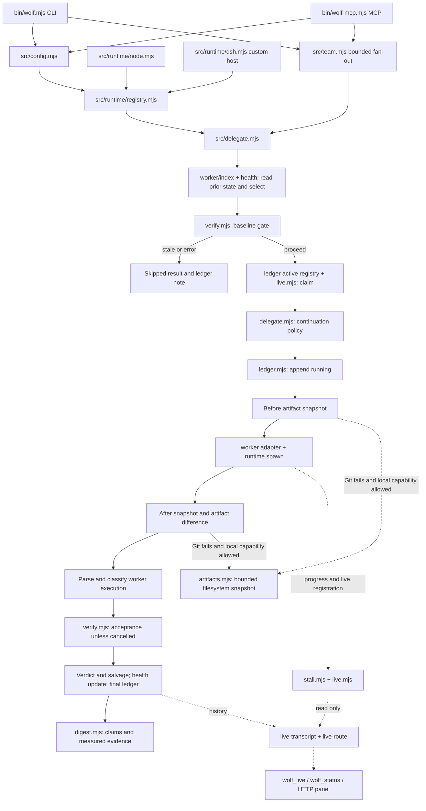
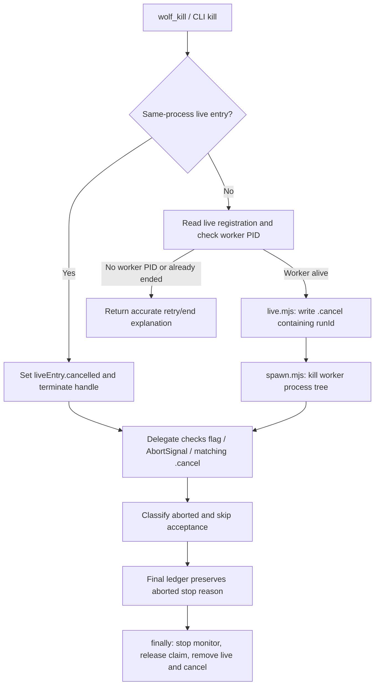

# Universal Wolfpack architecture

[中文](ARCHITECTURE.md) | English | [README](../README.en.md) | [Configuration](CONFIGURATION.en.md)

This document describes the implementation in `universal/`, not an assumed shared implementation across editions. CLI and MCP are thin host entry points around the same task engine. The default host is Node.js; custom hosts can inject a process runtime without installing a complete DSH/Cordis plugin.

## Module map

Paths below are relative to the universal edition and link to the actual source.

| Module | Responsibility |
| --- | --- |
| [bin/wolf.mjs](../bin/wolf.mjs) | CLI parsing; delegate/status/kill/team/live/panel/health commands; config, runtime, and ledger setup |
| [bin/wolf-mcp.mjs](../bin/wolf-mcp.mjs) | stdio JSON-RPC MCP server; six tool schemas and handlers; shared ledger and reusable panel server |
| [src/config.mjs](../src/config.mjs) | Upward config search, environment/file merging, path expansion, execution/continuation/state/panel settings |
| [src/runtime/registry.mjs](../src/runtime/registry.mjs) | Resolve explicit runtime, injected default, or undefined for built-in fallback |
| [src/runtime/node.mjs](../src/runtime/node.mjs) | Node process adapter, local-snapshot capability, optional macOS stall notifier; import registers the default runtime |
| [src/runtime/dsh.mjs](../src/runtime/dsh.mjs) | Adapt Cordis subprocess handles and collected streams to the core contract |
| [src/worker/index.mjs](../src/worker/index.mjs) | Worker registry, executable availability, preference/fallback, health filtering, continuation affinity, process-local rotation |
| [src/worker/agy.mjs](../src/worker/agy.mjs), [claude.mjs](../src/worker/claude.mjs) | Build argv, parse stdout/session/usage/claims, classify worker execution; conversation versus resume IDs |
| [src/worker/faults.mjs](../src/worker/faults.mjs) | Capacity/quota, authentication, timeout, missing-output, and ordinary worker fault signals |
| [src/worker/health.mjs](../src/worker/health.mjs) | Persisted cooldown state, serialized read-modify-write and temporary-file replacement, reset and read-only health snapshots |
| [src/delegate.mjs](../src/delegate.mjs) | Complete delegation orchestration, continuation, artifact comparison, cancellation, dispatch/final ledger records, acceptance salvage |
| [src/spawn.mjs](../src/spawn.mjs) | Built-in process spawning, bounded collected output, timeout/AbortSignal, process-tree termination |
| [src/artifacts.mjs](../src/artifacts.mjs) | Bounded non-Git filesystem snapshot with canonicalized exclusions |
| [src/verify.mjs](../src/verify.mjs) | Platform shell selection, sequential baseline/acceptance execution, baseline decision, diagnostic failure signals |
| [src/ledger.mjs](../src/ledger.mjs) | NDJSON append, cached/incremental reads, folded task state, compaction, in-process active-task claims |
| [src/digest.mjs](../src/digest.mjs) | Bounded result/status/health presentation; worker claims and independently measured evidence remain separate |
| [src/team.mjs](../src/team.mjs) | Validate one–eight tasks, reject duplicate IDs/unknown keys, bounded concurrency and isolated task errors |
| [src/live.mjs](../src/live.mjs) | Cross-process live records, process liveness, separate run-matched cancellation request files |
| [src/stall.mjs](../src/stall.mjs) | Per-worker session progress sampling and bounded warning levels; no termination capability |
| [src/live-transcript.mjs](../src/live-transcript.mjs) | Worker-specific bounded transcript tail parsing and cache |
| [src/live-route.mjs](../src/live-route.mjs) | Merge live/ledger state, group and bound payloads, read-only HTTP panel/live/health routes |
| [src/panel-html.mjs](../src/panel-html.mjs), [panel-client.js](../src/panel-client.js) | Build-free panel markup and browser refresh/rendering |

## Execution path and observation side path

Worker selection happens **before** baseline execution. Consequently, delegation still requires an available worker even if a supplied baseline would later return `stale`; status/health operations do not. A baseline skip does not claim or spawn a task and records the prior round rather than advancing it.

After the gate, the active registry synchronously claims the ID. A disk live record checks another owner's liveness; stale records are removed. The disk check is not an atomic cross-process lock. The delegate publishes its owner PID and later its worker PID, round, routing reason, cwd, session and stall sample. Dispatch is appended as `running` before the before-snapshot and spawn; final records complete the history. Failure after dispatch can leave a historical running trace, so a ledger trace alone is not proof of a currently alive worker.

The worker adapter supplies argv and parsing/classification. The runtime supplies a handle with `done`, collected stdout/stderr, PID, and `terminate`. Worker execution and shell checks go through the resolved runtime; without injection, the core falls back to `spawnProcess`. Observability uses separate session/file readers and does not delegate another model task or run acceptance.

## Routing, continuation, and health

Executable availability and provider health are separate. Absolute or separator-containing paths are checked as paths; bare executable names are searched on PATH. Selection throws when no registered worker is available. For an explicit preference, use it when available (even during cooldown, with an annotation), otherwise fall back to an available worker. Automatic routing removes cooling workers when possible, tries the earliest recovery if all are cooling, uses the sole healthy worker, preserves a prior healthy worker, then rotates for a new task. The rotation cursor lives in the process, not the ledger.

Continuation reads the folded prior task. It starts a new session for `continuation: never`, `fresh: true`, an explicit prior-round cap, reached token budget, missing-usage cap, or worker change. Otherwise it reuses the prior session ID when available. `agy` uses `--conversation`; Claude uses `--resume`, not an implicit “latest conversation.” The next task round advances regardless of session reuse.

Health is updated after execution and acceptance/salvage. It answers whether a worker should be chosen next; it does not assign the task's acceptance verdict. Completed execution counts as health success, even when acceptance fails. Cancelled/skipped work is neutral. Infrastructure faults cool down immediately, ordinary errors after the threshold. Missing/corrupt health files are empty state; writes serialize within the process and replace a temporary file. This is not a distributed transaction across multiple independent hosts.

## Baseline, artifacts, and verdicts

`runVerify` runs checks sequentially through a shell and retains bounded output tails and extracted failure signals. Baseline policy first rejects any check that did not start; then any success gives `stale`; then an all-timeout set gives `error`; otherwise failure evidence permits execution. An empty baseline permits execution. These are problem reproduction gates, not a general passing health checklist.

Acceptance `pass` requires nonempty results and every registered valid command to have run successfully. Any result that did not run gives `error`; all-ran results with a failure give `fail`; no results give `unverified`. Cancellation produces no later acceptance results. Worker `stop_reason` and acceptance `verdict` are separate fields. Artifact changes can recover a self-reported worker error to `completed`; all-passing acceptance can also recover an execution error. Neither recovery fabricates a passing acceptance result.

Git evidence is a before/after dirty **path-set** comparison; it can miss edits to previously dirty paths or changes committed during the run. Non-Git fallback in `artifacts.mjs` compares `size:mtimeMs` maps, including deletions. It is permitted only for the built-in fallback or a runtime with `supportsLocalArtifactSnapshot === true`; `NodeRuntime` advertises the capability. A custom runtime without the capability returns undetermined evidence after a Git failure rather than scanning the host filesystem implicitly.

The filesystem walker visits at most 10,000 entries, skips symlinks and `.git` / `.wolfpack` / `.dsh` / `node_modules`, and receives raw-directory, ledger-file, and health-file exclusions from `delegate.mjs`. Roots/exclusions resolve through `realpath`; for absent paths, existing parents are resolved before the leaf is restored. Exclusions use equality or path-separator boundaries, not unsafe string-prefix matches. Permission errors or exceeded bounds discard the entire snapshot. Metadata-preserving writes can be missed; a custom stall log outside the excluded directories can appear as a change. Files claimed outside the workspace lower the reported evidence scope to undetermined. Explicit verification remains the correctness authority.

## Cancellation and cleanup

The disk cancellation request is separate from periodic live samples, which can therefore never overwrite it. Matching `runId` prevents a request for an old run from cancelling a later run with the same task ID. Cross-process cancellation targets the worker PID, not the shared MCP owner PID. A cancel without a published worker PID returns a retryable reason. Cancellation preserves edits already written; it is not rollback. Local cancellation and AbortSignal also prevent the normal worker-error salvage path from overwriting the aborted execution classification.

## Read-only observation

Stall monitors inspect each worker's own storage. `agy` uses its brain/conversation files under `~/.gemini/antigravity-cli`; Claude Code uses project/session JSONL under `~/.claude/projects`. Defaults warn at 5/10/15 minutes and then stop; they never call a termination function. Unreliable session evidence is unavailable, not invented progress.

Live payloads merge active handles, disk live registration and folded history, then group by worker and bound the response. Transcript parsing is a bounded tail sample rather than full-history replay. `wolf_live` defaults to no transcript, while the browser panel can display session tails without continually expanding the captain's conversation. The panel defaults to loopback, supports token authentication, reuses a server within the MCP process, and falls back to a free port if the requested port is occupied. Its HTTP routes (`/wolfpack/panel`, `/wolfpack/live`, `/wolfpack/health`) are observation paths, not dispatch or cancellation endpoints.

Current wiring limitation: CLI live/panel and MCP `liveDataSources()` omit the loaded `workerHealth` object expected by `buildLivePayload()`. Health rendering in those payloads can therefore be empty/default; CLI `health` and status read the actual configured file. A custom payload host should provide `workerHealth` explicitly. Similarly, CLI/MCP team handlers do not consume loaded `config.concurrency`; callers must set the team argument to override the core default of two.

## Programmatic boundary

The [manifest](../package.json) exports `core/config`, `core/delegate`, `core/worker`, `core/team`, `runtime/node`, `runtime/dsh`, and `package.json`. Runtime selection is explicit runtime → injected default → built-in Node fallback. Importing the Node adapter registers it. Custom hosts must satisfy the process-handle contract and make a deliberate local-snapshot capability choice; a DSH runtime adapter does not install the DSH native plugin/UI.

The package has no third-party runtime dependency. The source checkout also contains offline tests and bilingual guides; the package file allowlist does not explicitly include `tests` or root English guides. Other editions, historical `lib/*` modules and native DSH plugin entry points are separate interfaces. See [configuration](CONFIGURATION.en.md), the [captain's handbook](../briefing.en.md), and [migration notes](../../docs/MIGRATION.md).
