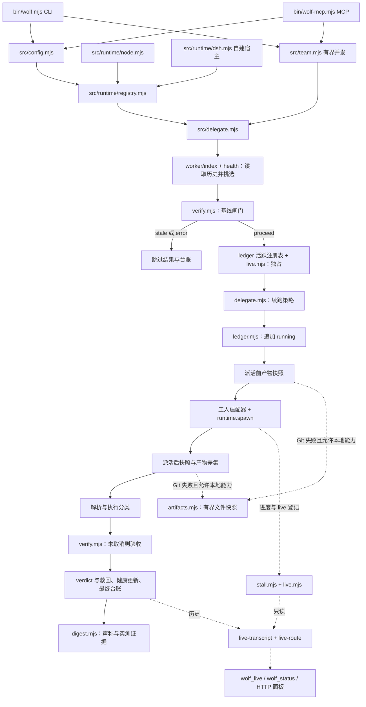
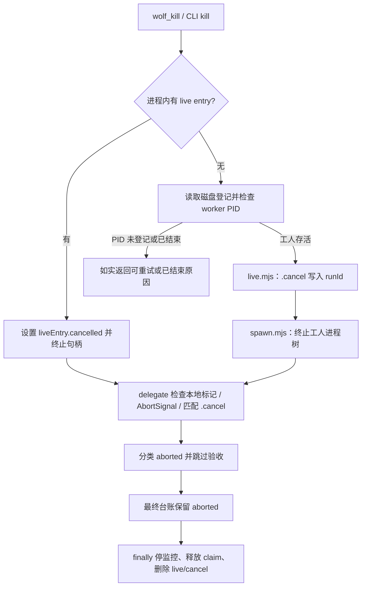

# Wolfpack 通用版架构

中文 | [English](ARCHITECTURE.en.md) | [README](../README.md) | [配置参考](CONFIGURATION.md)

本文对应 `universal/` 的实际实现，不假定三版同名工具共用完全相同的代码。CLI 与 MCP 是同一任务引擎的宿主入口；默认宿主为 Node.js，自建宿主可以注入进程运行时，而无需安装完整 DSH/Cordis 插件。

## 模块与职责

以下路径均相对通用版根目录，链接指向真实源码。

| 模块 | 职责 |
| --- | --- |
| [bin/wolf.mjs](../bin/wolf.mjs) | CLI 参数解析；delegate/status/kill/team/live/panel/health；装配配置、运行时、台账 |
| [bin/wolf-mcp.mjs](../bin/wolf-mcp.mjs) | stdio JSON-RPC MCP；六工具 schema 和处理器；共享台账与可复用面板服务 |
| [src/config.mjs](../src/config.mjs) | cwd 向上查配置、环境变量合并、路径展开、执行/续跑/状态/面板设置 |
| [src/runtime/registry.mjs](../src/runtime/registry.mjs) | 解析显式运行时、默认注入，或返回 undefined 交由调用处使用内置实现 |
| [src/runtime/node.mjs](../src/runtime/node.mjs) | Node 进程适配、本地快照能力、可选 macOS 停滞通知；导入即注册默认运行时 |
| [src/runtime/dsh.mjs](../src/runtime/dsh.mjs) | 把 Cordis 子进程句柄与 collected 流归一为核心契约 |
| [src/worker/index.mjs](../src/worker/index.mjs) | 工人注册、可执行入口探测、偏好/回退、健康过滤、续跑沿用、进程内轮换 |
| [src/worker/agy.mjs](../src/worker/agy.mjs)、[claude.mjs](../src/worker/claude.mjs) | argv、stdout/会话/用量/自述解析、执行分类；conversation 与 resume 各自独立 |
| [src/worker/faults.mjs](../src/worker/faults.mjs) | 容量/额度、鉴权、超时、无输出、普通工人故障识别 |
| [src/worker/health.mjs](../src/worker/health.mjs) | 冷却台账、串行读改写与临时文件替换、重置及只读健康快照 |
| [src/delegate.mjs](../src/delegate.mjs) | 委派编排、续跑、产物差集、取消、派发/收尾台账、验收救回 |
| [src/spawn.mjs](../src/spawn.mjs) | 内置进程启动、有界输出收集、超时/AbortSignal、进程树终止 |
| [src/artifacts.mjs](../src/artifacts.mjs) | 非 Git 有界文件快照与真实路径排除 |
| [src/verify.mjs](../src/verify.mjs) | 平台 shell、顺序执行基线/验收、基线判定、失败信号提取 |
| [src/ledger.mjs](../src/ledger.mjs) | NDJSON 追加、缓存/增量读、任务折叠、压缩、进程内任务独占 |
| [src/digest.mjs](../src/digest.mjs) | 有界结果/状态/健康摘要；自述与实测证据分段 |
| [src/team.mjs](../src/team.mjs) | 1–8 任务校验、重复 ID/未知字段拒绝、有界并发、异常隔离 |
| [src/live.mjs](../src/live.mjs) | 跨进程 live 登记、存活探测、独立且匹配 runId 的取消请求文件 |
| [src/stall.mjs](../src/stall.mjs) | 各工人会话进度采样与有限级报警；没有终止能力 |
| [src/live-transcript.mjs](../src/live-transcript.mjs) | 工人专属会话尾读与缓存 |
| [src/live-route.mjs](../src/live-route.mjs) | 合并运行/台账、分工人且有界的载荷、只读 HTTP 面板/live/health |
| [src/panel-html.mjs](../src/panel-html.mjs)、[panel-client.js](../src/panel-client.js) | 无构建面板 HTML 与浏览器刷新渲染 |

## 执行主线与观察旁路

挑选工人实际在基线之前，因此即使基线可能返回 `stale`，delegate 仍先要求有可用工人；status/health 查询不要求工人。基线跳过不独占、不启动工人，台账记原轮数而不增加执行轮次。

闸门放行后先在进程内同步 claim，再检查跨进程 live 记录的宿主存活并清理残留。这不是原子跨进程文件锁。live 先发布宿主 PID，启动后再发布 worker PID、轮次、路由原因、cwd、会话与停滞样本。`running` 在前快照与 spawn 之前追加，最终记录补全历史；派发后异常可能留下历史 running 痕迹，不能仅凭此推断工人仍存活。

工人适配器负责 argv 与解析/分类；运行时负责 `done`、collected stdout/stderr、PID、`terminate` 句柄。工人及 shell 检查走解析后的运行时；未注入时回退 `spawnProcess`。观察使用独立会话/文件读取器，不额外派模型，也不执行验收。

## 路由、续跑、健康

可执行入口存在与供应商健康是两件事。绝对路径或带分隔符路径按路径检测，裸命令按 PATH 搜索；没有可用工人则报错。显式偏好优先使用可用者（即使冷却也可使用并标注），不可用则回退。自动策略先过滤冷却工人；全冷却则尝试最早恢复者；否则依次唯一健康工人、上一轮仍健康工人、新任务轮换。轮换游标只在进程中，不存入台账。

续跑读取折叠后的任务历史。`continuation: never`、`fresh: true`、显式轮次上限、达到累计 token 预算、未知用量轮次上限或切换工人均冷启动；其余有会话 ID 时复用。agy 用 `--conversation`，Claude 用 `--resume`，不靠“最近会话”猜测。是否续用会话不改变本轮轮数递增。

健康在执行、验收/救回之后更新，只回答下一轮挑谁。执行 completed 可记健康成功，即使验收失败；取消/基线跳过中立；自身故障立即冷却，普通错误累计阈值冷却。文件缺失或损坏当空状态；同进程写入串行化并用临时文件替换，但不是跨多个宿主的分布式事务。

## 基线、产物与严格判定

`runVerify` 顺序通过 shell 执行，保留有界输出尾部与失败信号。基线先检查未启动项（error），再检查通过项（stale），再检查全超时（error），其余有失败证据则放行；空基线直接放行。它用于复现当前问题，不应填普通已通过的健康检查清单。

验收 `pass` 要求非空结果且全部登记的有效命令确实执行并成功；任何未执行项为 error；全部执行但有失败为 fail；无结果为 unverified。取消不再执行后续验收。工人 `stop_reason` 与验收 `verdict` 是两个维度。磁盘变化可以把自报 ERROR 救回 completed，验收全过也可救回执行 error；两者均不能凭空制造通过证据。

Git 用前后 dirty 路径集合差集，可能漏掉原本已 dirty 的文件继续修改，或工人自行提交后恢复干净的改动。非 Git 的 `artifacts.mjs` 比较 `size:mtimeMs` 映射并识别删除；仅内置回退或 `supportsLocalArtifactSnapshot === true` 的运行时启用，`NodeRuntime` 声明此能力。自建运行时没有声明能力时，Git 失败后如实无法判定，不隐式扫描本机。

文件扫描最多访问 10000 条目，不跟随符号链接，跳过 `.git`、`.wolfpack`、`.dsh`、`node_modules`；delegate 显式传入 rawDir、ledgerPath、health file 排除。工作区与排除路径经过 realpath，未创建的路径先解析已有父目录再还原末级；比较按路径相等或分隔符边界，不误伤同前缀文件。权限失败或超限丢弃整份快照。大小与时间均未变化的写入可能漏检；自定义 stall 日志在排除目录外时仍可能成为变化。声称工作区外路径会降低证据范围为无法判定。正确性最终靠明确验收。

## 取消与清理

独立 `.cancel` 请求不会被周期性 live 样本覆盖；按 runId 匹配避免同 task_id 的旧请求误伤新轮次。跨进程取消杀 worker PID，不杀共享 MCP 宿主 PID。尚无工人 PID 时返回可重试原因；取消不回滚已经写入的文件。本地取消与 AbortSignal 同样阻止正常错误救回覆盖 aborted 分类。

## 只读观察与发布边界

停滞按各工人自己的存储采样：agy 的 brain/conversations 在 `~/.gemini/antigravity-cli`，Claude Code 项目/会话 JSONL 在 `~/.claude/projects`。默认 5/10/15 分钟报警后停止，没有自动终止；不可靠会话证据报 unavailable。

live 合并进程句柄、磁盘登记与折叠历史，按工人分区并限制响应；流水是有界尾读而非完整回放。`wolf_live` 默认不附流水，浏览器面板可持续看尾部而不持续灌入队长上下文。面板默认 loopback，支持口令，同 MCP 进程复用服务，端口冲突换空闲端口；`/wolfpack/panel`、`/wolfpack/live`、`/wolfpack/health` 都是观察旁路，没有 HTTP 派活/取消入口。

当前接线限制：CLI live/panel 与 MCP `liveDataSources()` 未把加载后的 `workerHealth` 传给 `buildLivePayload()`，其健康区域可能显示空/默认状态；CLI health 与 status 才读取实际配置文件。自建载荷宿主应显式传 `workerHealth`。另外 CLI/MCP team 不使用加载后的 `config.concurrency`，需在调用参数中指定才能覆盖核心默认并发 2。

[package.json](../package.json) 导出 `core/config`、`core/delegate`、`core/worker`、`core/team`、`runtime/node`、`runtime/dsh` 与 `package.json`。显式 runtime → 默认注入 → 内置 Node；导入 Node 适配即注册。自建宿主需满足句柄契约并明确本地快照能力；DSH runtime 适配器不等于 DSH 原生插件/UI 安装。

包没有第三方运行时依赖。源码包含离线测试与双语指南；当前文件白名单未显式列 `tests` 或根英文指南。其他版本、历史 `lib/*` 与 DSH 插件入口属于不同接口。参见[配置](CONFIGURATION.md)、[队长任务书](../briefing.md)、[迁移说明](../../docs/MIGRATION.md)。
